# AWS Aurora DSQL Architecture and Availability

*Active active and active standby applications and measured availability*

This Markdown edition includes expanded investigations of regional routing and recovery dependencies, and customer recovery and root cause analysis, reviewed on 14 November 2026. Page references refer to the earlier 44-page PDF and Word edition. The expanded material is presented in the two named Markdown sections.

**Expanded investigations:** [Regional routing and recovery dependencies](#regional-routing-and-recovery-dependencies) | [Customer recovery and root cause analysis](#customer-recovery-and-root-cause-analysis).

14 November 2026  |  CTO and architecture review  |  Documentation reviewed visual edition

**Decision.** Choose the application operating model from tested recovery, business correctness, and diagnostic evidence. An active-active database can support either active-active or active-standby applications.

**Availability.** Compare customer outcomes against a defined SLO. AWS service SLAs, observed uptime, and recovery exercises provide different evidence; the analysis on pages 31 to 38 explains the relationship. [\[S47\]](https://docs.aws.amazon.com/wellarchitected/latest/framework/rel_withstand_component_failures_service_level_agreements.html) [\[S49\]](https://docs.aws.amazon.com/AmazonCloudWatch/latest/monitoring/CloudWatch-ServiceLevelObjectives.html)

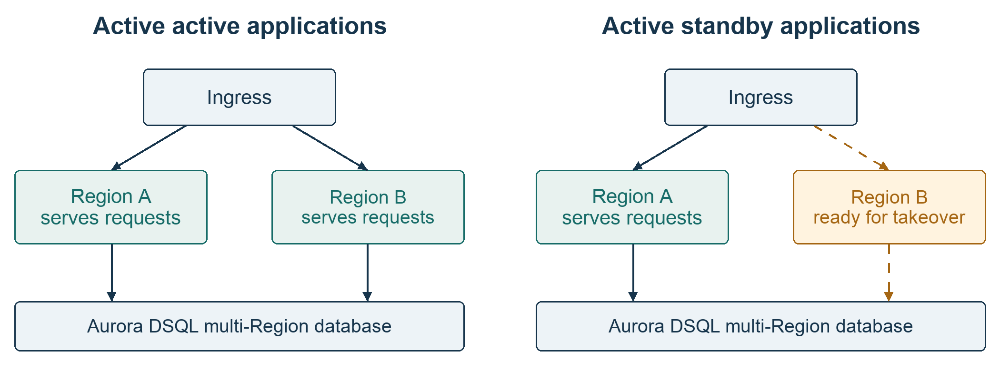

Figure 1. Application traffic and database replication are separate decisions. Dashed paths represent standby takeover paths; standby capacity depends on the selected strategy. Schematic, not a measured failover result.

| **Decision test** | **Evidence to require** |
| --- | --- |
| Why multiple active application Regions | A business recovery or geography need that justifies the operating model |
| Can concurrent execution stay correct | Atomic state boundaries, stable operation keys, safe effects, and worker takeover |
| Can responders explain a failure | One business operation reconstructed across Regions, attempts, and effects |

**CTO concern.** Preserve evidence while restoring service; root cause analysis can continue after recovery. Define operation identity, ownership, and external outcomes, then test investigation effort for both models. [\[S58\]](https://docs.aws.amazon.com/prescriptive-guidance/latest/aws-multi-region-fundamentals/fundamental-1.html) [\[S14\]](https://docs.aws.amazon.com/wellarchitected/latest/framework/ops_observability_dist_trace.html)

**Scope.** Two serving application Regions with multi-Region Aurora DSQL. All diagrams are illustrative. Difficulty grouping and acceptance criteria are proposed review practices. No measured latency, cost, carbon, RTO, or RPO result is implied.

**Reading path.** Architecture 1 to 3; difficulties 4 to 24; validation 25 to 26; playbook 27; decision 28; references 29 to 30; availability 31 to 39; AWS strategy and operations 40 to 44.

## Database topology and application responsibilities

![Aurora DSQL multi-Region topology: two active Regions and a third witness Region. The witness has no client endpoint. Lines indicate managed database participation, not a full mesh protocol. \[S33\]](aws_aurora_dsql_architecture_and_availability_report_assets/figure-02.png)

Figure 2. Aurora DSQL multi-Region topology: two active Regions and a third witness Region. The witness has no client endpoint. Lines indicate managed database participation, not a full mesh protocol. [\[S33\]](https://docs.aws.amazon.com/aurora-dsql/latest/userguide/getting-started.html)

| **Capability** | **Aurora DSQL behavior** | **Application responsibility** |
| --- | --- | --- |
| Regional access | Two active regional clusters and a third witness Region. [\[S33\]](https://docs.aws.amazon.com/aurora-dsql/latest/userguide/getting-started.html) | Select the application ingress and database endpoint. |
| Atomic changes | Multi-row ACID transactions with snapshot isolation. [\[S04\]](https://docs.aws.amazon.com/aurora-dsql/latest/userguide/working-with-concurrency-control.html) | Model and protect business invariants within each transaction. |
| Concurrency | OCC validates conflicts at commit. [\[S04\]](https://docs.aws.amazon.com/aurora-dsql/latest/userguide/working-with-concurrency-control.html) | Handle conflicts and uncertain outcomes with safe retry logic. |
| Recovery | AWS manages database recovery. [\[S02\]](https://docs.aws.amazon.com/aurora-dsql/latest/userguide/disaster-recovery-resiliency.html) | Recover customer paths, workers, dependencies, and external effects. |

**Coordination boundary.** DSQL uses its witness for recovery and transactional quorum. Database recovery and application traffic movement are separate responsibilities. Treat regional outage, client-path failure, and coordination failure as separate tests. [\[S33\]](https://docs.aws.amazon.com/aurora-dsql/latest/userguide/getting-started.html) [\[S02\]](https://docs.aws.amazon.com/aurora-dsql/latest/userguide/disaster-recovery-resiliency.html) [\[S11\]](https://aws.amazon.com/blogs/database/implement-multi-region-endpoint-routing-for-amazon-aurora-dsql/)

**Topology selection.** Choose a supported DSQL Region combination that meets application latency and data-location requirements. Test both regional endpoints and recovery paths before approving the architecture. [\[S33\]](https://docs.aws.amazon.com/aurora-dsql/latest/userguide/getting-started.html)

## The twenty difficulties across six pillars

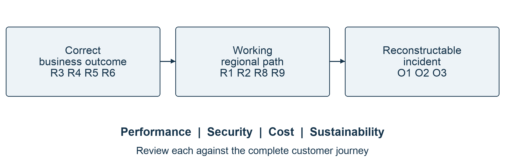

Figure 3. Proposed order of architecture proof. Work on operational evidence alongside correctness and recovery; this is not a ranking of AWS pillars.

| **Primary pillar** | **Difficulties examined** | **Key outcome** |
| --- | --- | --- |
| Operational Excellence | O1 RCA evidence; O2 releases and configuration; O3 incident and recovery procedures | Explain changes and incidents; recover using practiced actions. |
| Reliability | R1 ingress routing; R2 database endpoint recovery; R3 invariants; R4 retries; R5 external effects; R6 workers; R7 derived state; R8 dependencies; R9 capacity; R10 logical recovery | Preserve business correctness and continue customer journeys through failures. |
| Performance Efficiency | P1 geographic latency; P2 contention and connection pressure | Meet latency and throughput objectives in normal and degraded states. |
| Security | S1 access and credentials; S2 routing boundaries and telemetry protection | Preserve authorization and data protection during recovery. |
| Cost Optimization | C1 complete operating cost | Compare alternatives against the same recovery and service objectives. |
| Sustainability | U1 utilization and redundant work; U2 data lifecycle and movement | Reduce resource use per successful business outcome. |

The pillars follow AWS Well-Architected; O1 to U2 are local report references. Routing has primary ownership under Reliability and overlaps Operational Excellence and Performance Efficiency. [\[S01\]](https://docs.aws.amazon.com/wellarchitected/latest/framework/definitions.html)

RTO is acceptable recovery duration; RPO is acceptable data loss expressed as a time window. Durable outbox and workflow records can inherit database durability while delivery or business completion remains pending. [\[S16\]](https://docs.aws.amazon.com/prescriptive-guidance/latest/cloud-design-patterns/transactional-outbox.html)

## O1 Cross Region observability and root cause analysis

![Illustrative causal sequence. Operation identity remains stable while attempt identity and serving Region change. Retain the committed outcome separately from sampled traces. \[S14\]](aws_aurora_dsql_architecture_and_availability_report_assets/figure-04.png)

Figure 4. Illustrative causal sequence. Operation identity remains stable while attempt identity and serving Region change. Retain the committed outcome separately from sampled traces. [\[S14\]](https://docs.aws.amazon.com/wellarchitected/latest/framework/ops_observability_dist_trace.html)

**Failure scenario.** A user retries after a timeout and receives an inconsistent application outcome. Requests in both Regions appear successful locally, while the business operation remains incomplete.

**Database boundary.** Database correctness narrows the hypotheses, but does not supply a complete application causality record. AWS recommends distributed tracing across the request path. [\[S14\]](https://docs.aws.amazon.com/wellarchitected/latest/framework/ops_observability_dist_trace.html)

**Design and operation.** Assign a stable business operation ID, a distinct attempt ID, and trace/span context. Carry causation and correlation IDs through messages. Record application Region, selected database endpoint, release/configuration version, outcome, retry reason, message ID, and external reference. Use operation IDs in logs and traces; avoid creating unbounded metric dimensions. Preserve regional visibility even if a central telemetry collector is unavailable.

**RCA evidence.** Keep structured operation state transitions as durable business evidence. Use traces for timing and dependency paths, metrics for affected scope, and configuration/audit history for changes. UTC timestamps assist alignment, but causation IDs and entity versions establish ordering more reliably than wall clocks alone. Sampled traces are not a complete audit ledger.

**Validation.** Inject a lost response followed by a retry in the other Region. An engineer unfamiliar with the exercise should identify each attempt, the committed result, and any external effect from retained evidence. Agree an investigation target before testing.

## O2 Release compatibility and configuration drift

![A proposed staged release sequence and the decision boundary in AWS regional failover guidance. Automatic local recovery and preconfigured health-based routing remain separate mechanisms. \[S19\] \[S13\]](aws_aurora_dsql_architecture_and_availability_report_assets/figure-05.png)

Figure 5. A proposed staged release sequence and the decision boundary in AWS regional failover guidance. Automatic local recovery and preconfigured health-based routing remain separate mechanisms. [\[S19\]](https://aws.amazon.com/builders-library/automating-safe-hands-off-deployments/) [\[S13\]](https://docs.aws.amazon.com/prescriptive-guidance/latest/aws-multi-region-fundamentals/fundamental-4.html)

**Failure scenario.** Region A writes a new status or message format while Region B still runs an older version. Both use the same correct database, yet the older consumer rejects or misinterprets the change.

**Database boundary.** A consistent shared store exposes new data promptly; it does not make mixed application versions compatible. DSQL schema changes can also cause transient catalog-related OCC responses. [\[S04\]](https://docs.aws.amazon.com/aurora-dsql/latest/userguide/working-with-concurrency-control.html)

**Design and operation.** Use an expand-migrate-contract sequence: introduce compatible readers, add optional fields, migrate behavior, then remove old representations only after every consumer is ready. Version messages and configuration. Roll out code, feature flags, routing policies, and infrastructure one Region at a time with observation periods. [\[S13\]](https://docs.aws.amazon.com/prescriptive-guidance/latest/aws-multi-region-fundamentals/fundamental-4.html) Define a rollback that remains compatible with data already written by the new version. AWS treats configuration changes as deployment risks too. [\[S19\]](https://aws.amazon.com/builders-library/automating-safe-hands-off-deployments/)

**RCA evidence.** Record the exact artifact digest and configuration revision in both Regions, together with migration progress, feature-flag changes, and the first failing operation. Compare behavior using equivalent requests rather than raw regional totals.

**Validation.** Run old and new versions concurrently, then roll back after the new version has created data. Verify API behavior, message consumers, idempotency lookup, and workflow continuation.

## O3 Recovery decisions and incident coordination

![AWS guidance recommends named humans decide regional failover activation, followed by automated execution. Define separate local automatic recovery criteria to prevent conflicting actions. \[S13\]](aws_aurora_dsql_architecture_and_availability_report_assets/figure-06.png)

Figure 6. AWS guidance recommends named humans decide regional failover activation, followed by automated execution. Define separate local automatic recovery criteria to prevent conflicting actions. [\[S13\]](https://docs.aws.amazon.com/prescriptive-guidance/latest/aws-multi-region-fundamentals/fundamental-4.html)

**Failure scenario.** Two responders independently change application routing and database endpoint preferences. Traffic oscillates and long-running work is restarted repeatedly.

**Database boundary.** Automatic database recovery does not establish the organization's authority to evacuate an application Region, pause jobs, or fail back.

**Design and operation.** Define one incident commander, one routing change owner, and named owners for customer correctness and telemetry. AWS Multi-Region Fundamentals recommends a human decision by predetermined responders to activate regional failover, followed by automated execution. [\[S13\]](https://docs.aws.amazon.com/prescriptive-guidance/latest/aws-multi-region-fundamentals/fundamental-4.html) Distinguish that decision from preconfigured automatic local recovery and health-based ingress behavior. Define the scope and criteria of each mechanism, and prevent conflicting actions. Version the runbook and use the same recovery mechanism during exercises and real events.

**RCA evidence.** Retain a timeline of detection, decisions, routing state, worker ownership changes, customer recovery, and reconciliation. Distinguish time to detect, time to restore service, and time to establish cause; do not combine them into one ambiguous MTTR value. See the parallel recovery and RCA exercise on page 43. [\[S58\]](https://docs.aws.amazon.com/prescriptive-guidance/latest/aws-multi-region-fundamentals/fundamental-1.html)

**Validation.** Conduct a blind exercise with an impaired monitoring component. The team must execute recovery using available evidence, retain an auditable action history, and restore traffic gradually without concurrent conflicting actions.

## R1 User traffic routing and meaningful health checks

![Two routing decisions: user to application and application to regional database access. A local database path is the baseline; scoped endpoint fallback requires its own policy. \[S12\] \[S11\]](aws_aurora_dsql_architecture_and_availability_report_assets/figure-07.png)

**Figure 7.** Two routing decisions: user to application and application to regional database access. A local database path is the baseline; scoped endpoint fallback requires its own policy. [\[S12\]](https://docs.aws.amazon.com/prescriptive-guidance/latest/aws-multi-region-fundamentals/fundamental-3.html) [\[S11\]](https://aws.amazon.com/blogs/database/implement-multi-region-endpoint-routing-for-amazon-aurora-dsql/) [\[S57\]](https://aws.amazon.com/blogs/architecture/disaster-recovery-dr-architecture-on-aws-part-iv-multi-site-active-active/)

**Failure scenario.** The application returns HTTP 200 on a shallow health endpoint while customer writes fail because a required dependency is unavailable. Traffic remains in the impaired Region. In another scenario, an over-sensitive check marks both Regions unhealthy and recovery automation repeatedly reverses its decision.

**Database boundary.** Aurora DSQL cannot choose a healthy application entry point for the user. AWS guidance recommends localizing regional application dependencies; the DSQL endpoint-routing example addresses a separate database-access decision. [\[S12\]](https://docs.aws.amazon.com/prescriptive-guidance/latest/aws-multi-region-fundamentals/fundamental-3.html) [\[S11\]](https://aws.amazon.com/blogs/database/implement-multi-region-endpoint-routing-for-amazon-aurora-dsql/)

**Design and operation.** Separate process liveness, readiness to accept work, and customer-journey health. Use bounded synthetic operations against designated test data. Avoid making every optional dependency a reason to evacuate an entire Region. Apply failure and recovery thresholds plus a stable observation period to prevent oscillation. Preconfigure the operator evacuation path. AWS recommends data-plane mechanisms such as health checks or ARC routing controls for recovery rather than depending on Route 53 control-plane record changes during an incident. [\[S07\]](https://docs.aws.amazon.com/Route53/latest/DeveloperGuide/best-practices-dns.html) [\[S10\]](https://docs.aws.amazon.com/r53recovery/latest/dg/routing-control.html)

### Suggested health design

| **Signal** | **Question answered** | **Routing implication** |
| --- | --- | --- |
| Process liveness | Is the process running? | Insufficient alone to prove customer success |
| Readiness | Can this instance accept work? | Controls local admission and load balancing |
| Customer journey | Can a representative business operation succeed? | Supports regional decisions with bounded synthetic checks |

## R1 Routing mechanisms and fallback behavior

![Illustrative all-unhealthy fallback behavior. Route 53 and standard Global Accelerator have documented fallback rules; continue to enforce correctness and authorization at the application. \[S08\] \[S09\]](aws_aurora_dsql_architecture_and_availability_report_assets/figure-08.png)

Figure 8. Illustrative all-unhealthy fallback behavior. Route 53 and standard Global Accelerator have documented fallback rules; continue to enforce correctness and authorization at the application. [\[S08\]](https://docs.aws.amazon.com/Route53/latest/DeveloperGuide/health-checks-how-route-53-chooses-records.html) [\[S09\]](https://docs.aws.amazon.com/global-accelerator/latest/dg/introduction-how-it-works.html)

| **Mechanism** | **Useful property** | **Difficulty that remains** |
| --- | --- | --- |
| Route 53 health based DNS | Selects healthy regional records; supports active-active or failover policies. | Resolvers and clients cache answers. DNS selection does not relocate established connections. [\[S07\]](https://docs.aws.amazon.com/Route53/latest/DeveloperGuide/best-practices-dns.html) |
| Global Accelerator standard accelerator | Static entry IPs; redirects new connections after endpoint health changes. | Established connections can continue toward the prior endpoint. It is an ingress option, not a direct DSQL database proxy. [\[S09\]](https://docs.aws.amazon.com/global-accelerator/latest/dg/introduction-how-it-works.html) |
| ARC routing control | Provides preconfigured routing switches and safety rules. | Application health, DNS/client behavior, and business ownership still need explicit handling. [\[S10\]](https://docs.aws.amazon.com/r53recovery/latest/dg/routing-control.html) |
| Client endpoint selection | Can react to the client's observed path and health. | Requires endpoint inventory, bounded retries, stable decision rules, and consistent policy across client versions. |

**Important failure behavior.** For a health-checked Route 53 record group with no healthy records, routing can treat the group as healthy; for failover records where both are unhealthy, the primary is returned. Standard Global Accelerator also has all-unhealthy fallback behavior. Health checks therefore are not an authorization barrier or a guaranteed traffic kill switch. [\[S08\]](https://docs.aws.amazon.com/Route53/latest/DeveloperGuide/health-checks-how-route-53-chooses-records.html) [\[S09\]](https://docs.aws.amazon.com/global-accelerator/latest/dg/introduction-how-it-works.html)

**RCA evidence.** Capture application Region in the response and access log, health-check transitions, routing configuration history, client geography/network cohort, DNS answers from representative resolvers, and connection reuse. A configured DNS weight is not a guaranteed per-request traffic percentage because answers can be cached.

**Validation.** Test a brownout that breaks writes but leaves the process alive, stale DNS caches, a long-lived connection, both Regions reported unhealthy, and intermittent health. Verify actual successful customer transactions and observed traffic movement rather than only the routing console status.

## R2 Database endpoint selection and connection recovery

![Classify the failing layer before changing a routing policy. Endpoint fallback is conditional and must preserve operation identity. \[S11\] \[S28\]](aws_aurora_dsql_architecture_and_availability_report_assets/figure-09.png)

Figure 9. Classify the failing layer before changing a routing policy. Endpoint fallback is conditional and must preserve operation identity. [\[S11\]](https://aws.amazon.com/blogs/database/implement-multi-region-endpoint-routing-for-amazon-aurora-dsql/) [\[S28\]](https://aws.amazon.com/blogs/database/amazon-aurora-dsql-connections-drivers-strings-and-best-practices/)

**Failure scenario.** The application is reachable, but its selected database endpoint is not. A connection pool keeps returning failed connections, or endpoint switching creates fresh connections with credentials scoped to the previous endpoint.

**Database boundary.** DSQL handles database recovery but exposes regional endpoints; AWS documents a separate endpoint-routing solution. That sample is a pattern to evaluate, not a universal production failover contract. [\[S11\]](https://aws.amazon.com/blogs/database/implement-multi-region-endpoint-routing-for-amazon-aurora-dsql/)

**Design and operation.** Choose between moving the complete customer journey and a narrowly scoped database-endpoint fallback. Prefer whole-stack evacuation when regional isolation is the goal; permit remote database access only for a defined partial failure with tested latency, security, and dependency behavior. Do not layer independent routing loops that repeatedly redirect one another. Cap connection creation and retire broken connections without assuming every application error requires a reconnect.

DSQL uses endpoint-scoped IAM tokens and client-side pooling. Token expiry governs new authentication; it does not end an established connection. [\[S32\]](https://docs.aws.amazon.com/aurora-dsql/latest/userguide/SECTION_authentication-token.html) The current connection duration limit is 60 minutes, separately from token validity; cap pool lifetimes below that limit and stagger recycling. Also respect the current connection creation limit of 100 per second per cluster. [\[S31\]](https://docs.aws.amazon.com/aurora-dsql/latest/userguide/CHAP_quotas.html) AWS connection guidance suggests client-side renewal before the limit. [\[S28\]](https://aws.amazon.com/blogs/database/amazon-aurora-dsql-connections-drivers-strings-and-best-practices/) Validate token and TLS behavior for every endpoint and use an appropriate supported connector.

**RCA evidence.** Separate DNS, TCP, TLS, authentication, pool acquisition, query execution, and commit timing. Record chosen endpoint, connection age, pool occupancy, retry classification, and SDK/driver version. Preserve the original failure when a later retry also fails.

**Validation.** Block one endpoint from the application, keep the application healthy, and observe recovery. Repeat with expired credentials, an exhausted pool, a burst of reconnects, and an interrupted commit. Confirm endpoint changes do not cause a business operation to be repeated unsafely.

## R3 Business invariants and transaction boundaries

![Proposed DSQL enforcement of a business invariant within one transaction. FOR UPDATE validates conflicts optimistically at commit. Snapshot isolation alone does not protect arbitrary predicates. \[S04\]](aws_aurora_dsql_architecture_and_availability_report_assets/figure-10.png)

Figure 10. Proposed DSQL enforcement of a business invariant within one transaction. FOR UPDATE validates conflicts optimistically at commit. Snapshot isolation alone does not protect arbitrary predicates. [\[S04\]](https://docs.aws.amazon.com/aurora-dsql/latest/userguide/working-with-concurrency-control.html)

**Failure scenario.** Two requests read available inventory and each accepts an order, or a workflow updates an order and a separate allocation record only partially.

**Database boundary.** DSQL provides snapshot-isolated transactions; this is not a promise that arbitrary cross-row predicates are protected automatically. [\[S04\]](https://docs.aws.amazon.com/aurora-dsql/latest/userguide/working-with-concurrency-control.html)

**Design and operation.** List the invariant first, such as inventory never becoming negative. In DSQL, use an atomic conditional transition or deliberately protect the decision rows within one transaction. SELECT FOR UPDATE uses optimistic conflict validation at commit; it does not acquire a traditional blocking row lock. [\[S04\]](https://docs.aws.amazon.com/aurora-dsql/latest/userguide/working-with-concurrency-control.html) Protecting selected existing rows does not by itself cover missing rows or arbitrary predicates; model an explicit guard or another proven invariant mechanism and test concurrent histories.

**RCA evidence.** Record entity version, expected precondition, operation ID, transition result, and conflict classification. Distinguish a correct business rejection from a transient concurrency failure.

**Validation.** Issue synchronized competing commands from both Regions. Assert the invariant over every accepted result and intermediate state. Include predicates spanning multiple rows; a test that merely checks final convergence is insufficient.

## R4 Safe retries and uncertain commit outcomes

![Proposed retry flow for an uncertain outcome. A timeout alone does not establish rollback; retain the operation key across Regions and attempts. \[S05\] \[S15\]](aws_aurora_dsql_architecture_and_availability_report_assets/figure-11.png)

Figure 11. Proposed retry flow for an uncertain outcome. A timeout alone does not establish rollback; retain the operation key across Regions and attempts. [\[S05\]](https://docs.aws.amazon.com/aurora-dsql/latest/userguide/troubleshooting.html) [\[S15\]](https://aws.amazon.com/builders-library/timeouts-retries-and-backoff-with-jitter/)

**Failure scenario.** The database commits, but a timeout prevents the caller receiving success. A cross-Region retry creates another reservation or increments a balance again.

**Database boundary.** AWS documents uncertain commit outcomes in DSQL: an error during commit can follow a successful commit. Check outcomes or make the transaction idempotent before retrying. [\[S05\]](https://docs.aws.amazon.com/aurora-dsql/latest/userguide/troubleshooting.html)

**Design and operation.** Generate one operation key before the first attempt and retain it across Regions, reconnects, and client retries. Bind it to the caller and request content so a reused key with a different payload is rejected. Persist the business change and its operation outcome in the same DSQL transaction, with conflict protection for concurrent attempts. Apply deadlines, capped exponential backoff, jitter, and one coordinated retry budget. [\[S04\]](https://docs.aws.amazon.com/aurora-dsql/latest/userguide/working-with-concurrency-control.html) [\[S15\]](https://aws.amazon.com/builders-library/timeouts-retries-and-backoff-with-jitter/)

**RCA evidence.** Maintain a per-operation attempt list and durable outcome state such as Pending, Completed, Rejected, or NeedsReconciliation. Do not interpret a missing response as a rollback. Record error type and attempt timing.

**Validation.** Lose the response immediately after commit, then retry in the other Region with the same key. Check that exactly one intended business effect occurs and that the caller obtains the prior result. Test key retention against the maximum replay window.

## R5 External effects and multi service workflows

![A DSQL transaction commits business rows and an outbox row together. The provider call is outside this atomic boundary. Relay delivery, provider idempotency, and reconciliation require explicit design. \[S16\]](aws_aurora_dsql_architecture_and_availability_report_assets/figure-12.png)

Figure 12. A DSQL transaction commits business rows and an outbox row together. The provider call is outside this atomic boundary. Relay delivery, provider idempotency, and reconciliation require explicit design. [\[S16\]](https://docs.aws.amazon.com/prescriptive-guidance/latest/cloud-design-patterns/transactional-outbox.html)

**Failure scenario.** A provider accepts a payment, shipping request, or notification, then the application crashes before saving the provider result. Alternatively, a database change commits but its event is never published.

**Database boundary.** A database transaction cannot atomically commit an independent provider call or ordinary message publication. AWS describes transactional outbox and saga patterns for these boundaries. [\[S16\]](https://docs.aws.amazon.com/prescriptive-guidance/latest/cloud-design-patterns/transactional-outbox.html)

**Design and operation.** Persist explicit intent and a stable external idempotency key before requesting an effect. Query the provider by that key when the outcome is unknown; compensate only when the business action is reversible and the compensation itself is safe to retry. In DSQL, an application outbox row can share the business transaction, with a deliberately designed relay. Track relay progress and reconcile uncertain provider outcomes. [\[S16\]](https://docs.aws.amazon.com/prescriptive-guidance/latest/cloud-design-patterns/transactional-outbox.html)

**RCA evidence.** Link operation ID, workflow step, provider idempotency key, provider reference, reconciliation attempts, and final business result. Treat externally accepted but locally unconfirmed work as an explicit state.

**Validation.** Crash immediately before and after the provider call and before and after event publication. A duplicate delivery must not repeat the business effect; a reconciliation process must find unfinished work without relying on one regional process memory.

## R6 Worker ownership schedulers and stale executors

![Proposed epoch check using illustrative epoch numbers. DSQL ownership validation and the protected change share one transaction with guard-row conflict protection. \[S04\]](aws_aurora_dsql_architecture_and_availability_report_assets/figure-13.png)

Figure 13. Proposed epoch check using illustrative epoch numbers. DSQL ownership validation and the protected change share one transaction with guard-row conflict protection. [\[S04\]](https://docs.aws.amazon.com/aurora-dsql/latest/userguide/working-with-concurrency-control.html)

**Failure scenario.** Both Regions start a daily job, or an old worker resumes after a pause while another worker has taken over its task. Both attempt a valid database update or external action.

**Database boundary.** Database consistency can support atomic ownership claims, but does not make a worker stop after it loses ownership. AWS warns that leases and leader election have subtle pause and timing failure modes. [\[S17\]](https://aws.amazon.com/builders-library/leader-election-in-distributed-systems/)

**Design and operation.** Prefer competing idempotent consumers or ownership scoped to an operation/entity over one global leader. Use a deterministic job identity and atomic version/epoch claims. In DSQL, validate ownership and mutate protected state in one transaction with conflict protection on the guard row. [\[S04\]](https://docs.aws.amazon.com/aurora-dsql/latest/userguide/working-with-concurrency-control.html) For external effects, require receiver-side fencing where supported, otherwise use the provider idempotency contract and reconciliation. A separate lease check followed by an effect can race with takeover; lease expiry does not prove the old worker stopped.

**RCA evidence.** Record claim owner, ownership epoch, task attempt, renewal/expiry observations, and accepted or rejected completion. Track overlapping executions separately from duplicate business effects.

**Validation.** Pause a worker beyond its claim duration, transfer ownership, and resume the old worker. The stale executor must be unable to mutate authoritative state or duplicate an irreversible effect. Test missed schedules and overlap during failback.

## R7 Messages caches search indexes and other derived state

![Database consistency does not establish cache freshness, projection freshness, or single execution of a consumer effect. Track and rebuild derived state explicitly. \[S18\] \[S16\]](aws_aurora_dsql_architecture_and_availability_report_assets/figure-14.png)

Figure 14. Database consistency does not establish cache freshness, projection freshness, or single execution of a consumer effect. Track and rebuild derived state explicitly. [\[S18\]](https://aws.amazon.com/builders-library/caching-challenges-and-strategies/) [\[S16\]](https://docs.aws.amazon.com/prescriptive-guidance/latest/cloud-design-patterns/transactional-outbox.html)

**Failure scenario.** A current database record is displayed through an old cache entry, a delayed search index, or an event consumer that replays work in both Regions.

**Database boundary.** DSQL transaction consistency does not establish freshness for an application cache, search projection, or message pipeline. Each derived path needs its own freshness, delivery, and replay design. [\[S18\]](https://aws.amazon.com/builders-library/caching-challenges-and-strategies/) [\[S16\]](https://docs.aws.amazon.com/prescriptive-guidance/latest/cloud-design-patterns/transactional-outbox.html)

**Design and operation.** Classify each read as authoritative, bounded-stale, or best effort. Enforce critical decisions against authoritative state, not an asynchronous projection. Version derived records; detect gaps and support replay/rebuild. Use stable event identities and idempotent consumers when deliveries can repeat. Define consumer takeover and replay behavior across Regions. For an application cache, test invalidation loss and cold-start load. [\[S16\]](https://docs.aws.amazon.com/prescriptive-guidance/latest/cloud-design-patterns/transactional-outbox.html) [\[S18\]](https://aws.amazon.com/builders-library/caching-challenges-and-strategies/)

**RCA evidence.** Record source entity version, projection version, event ID and causation ID, oldest unprocessed age, dead-letter backlog, and deduplication decisions. Compare authoritative state with the exact version returned to the caller.

**Validation.** Delay and reorder independent messages, duplicate delivery, interrupt a consumer, and lose cache invalidation. Verify required freshness, safe processing, and replay beyond the normal retry period. Do not claim end-to-end exactly-once effects from queue deduplication alone.

## R8 Regional dependencies and partial failure

![A hidden application dependency across Regions can defeat application isolation. Managed database coordination is a separate, accepted service dependency. \[S12\]](aws_aurora_dsql_architecture_and_availability_report_assets/figure-15.png)

Figure 15. A hidden application dependency across Regions can defeat application isolation. Managed database coordination is a separate, accepted service dependency. [\[S12\]](https://docs.aws.amazon.com/prescriptive-guidance/latest/aws-multi-region-fundamentals/fundamental-3.html)

**Failure scenario.** Region B's application and database are healthy, but it retrieves configuration, identity metadata, images, or external credentials through Region A. A shared provider is down for both stacks.

**Database boundary.** Database replication does not replicate every dependency. AWS advises localizing regional dependencies and avoiding unnecessary application-layer cross-Region calls. [\[S12\]](https://docs.aws.amazon.com/prescriptive-guidance/latest/aws-multi-region-fundamentals/fundamental-3.html)

**Design and operation.** Map the complete customer journey, including identity, keys, DNS, certificates, configuration, artifacts, queues, object storage, provider access, and telemetry. Mark each dependency as regional, global, shared, or explicitly optional. Define usable degraded behavior per business capability and coordinate its regional recovery. [\[S12\]](https://docs.aws.amazon.com/prescriptive-guidance/latest/aws-multi-region-fundamentals/fundamental-3.html) [\[S13\]](https://docs.aws.amazon.com/prescriptive-guidance/latest/aws-multi-region-fundamentals/fundamental-4.html) Make recovery controls and credentials available outside the Region being evacuated. Accept the database's managed coordination dependencies explicitly rather than equating regional independence with zero network coordination.

**RCA evidence.** Record dependency target Region, timeout/error class, credentials source, connection path, and which journeys fail. Use external observation so a failed local monitoring system does not hide customer impact.

**Validation.** Disable one dependency while leaving compute and database healthy. Verify the unaffected business capabilities continue and the runbook chooses targeted degradation or regional evacuation based on the real dependency boundary.

## R9 Surviving capacity recovery sequencing and failback

![A regional evacuation combines multiple sources of load. Validate full-path capacity and control backlog admission; this diagram has no quantitative scale. \[S13\]](aws_aurora_dsql_architecture_and_availability_report_assets/figure-16.png)

Figure 16. A regional evacuation combines multiple sources of load. Validate full-path capacity and control backlog admission; this diagram has no quantitative scale. [\[S13\]](https://docs.aws.amazon.com/prescriptive-guidance/latest/aws-multi-region-fundamentals/fundamental-4.html)

**Failure scenario.** Region A loses traffic, Region B receives the combined load, and authentication calls, API quotas, connection creation, or a cold cache become the next bottleneck. Restoring A immediately creates another traffic surge.

**Database boundary.** Database elasticity does not reserve every application dependency or regional quota. Capacity must be assessed through the full customer path.

**Design and operation.** Load-test a single serving Region with the required customer mix, retry load, and background backlog. Prearrange quotas and enough ready capacity for the recovery target; scaling is a tested mechanism, not an assumed instantaneous action. Separate essential transactions from batch catch-up. Fail back gradually after verifying health, dependency readiness, cache behavior, and worker ownership. Keep a clear rollback for the failback itself. [\[S13\]](https://docs.aws.amazon.com/prescriptive-guidance/latest/aws-multi-region-fundamentals/fundamental-4.html)

**RCA evidence.** Measure successful business throughput, tail latency, rejected/admitted work, per-dependency throttling, connection creation, queue age, and time until stable service. Record new versus reused connections separately.

**Validation.** Evacuate one Region under representative peak load, then recover it with an accumulated backlog. The surviving Region must meet the agreed degraded-service objective; failback must preserve ownership and avoid oscillation.

## R10 Logical data damage and business recovery

![Synchronous replication can distribute a valid but unwanted write. Recovery needs tested history or backup plus downstream business reconciliation. \[S29\]](aws_aurora_dsql_architecture_and_availability_report_assets/figure-17.png)

Figure 17. Synchronous replication can distribute a valid but unwanted write. Recovery needs tested history or backup plus downstream business reconciliation. [\[S29\]](https://docs.aws.amazon.com/wellarchitected/latest/framework/rel-failmgmt.html)

**Failure scenario.** A buggy release issues valid but incorrect updates or deletes. Strong replication makes the incorrect state visible in every serving Region.

**Database boundary.** Synchronous replication protects against replica divergence within the service guarantees; it does not identify unwanted but authorized business changes. AWS requires tested recovery for logical as well as physical errors. [\[S29\]](https://docs.aws.amazon.com/wellarchitected/latest/framework/rel-failmgmt.html)

**Design and operation.** Maintain recoverable history and backups appropriate to the service and business process. Rehearse selective repair, full restore, application rebinding, and downstream reconciliation. During repair, prevent reintroduction of bad events or retries. Separate database restore success from restoration of customer-visible business correctness. Retain enough external references to reconcile effects that a restore cannot undo.

**RCA evidence.** Identify the first bad release/change, affected operation/entity set, last known correct state, backup/recovery point, and any irreversible external actions. Keep the repair decision and verification auditable.

**Validation.** In an isolated environment, introduce a bounded set of incorrect committed changes, restore or repair them, and replay only valid subsequent work. Verify queues, caches, projections, and external references after recovery.

## P1 Geographic latency and routing locality

![Latency and useful work must be measured across the complete path. Retry feedback can amplify load. Pipeline widths are not elapsed time. \[S15\]](aws_aurora_dsql_architecture_and_availability_report_assets/figure-18.png)

Figure 18. Latency and useful work must be measured across the complete path. Retry feedback can amplify load. Pipeline widths are not elapsed time. [\[S15\]](https://aws.amazon.com/builders-library/timeouts-retries-and-backoff-with-jitter/)

**Failure scenario.** A geographically closer API improves the first network hop, but end-to-end writes remain slow because the operation requires remote coordination or calls another service in the opposite Region.

**Database boundary.** The DSQL architecture paper describes coordination-free reads and write coordination at commit, rather than on every SQL statement. Geographic coordination can therefore affect commit latency even when the application uses a local endpoint. Validate the actual workload and topology. [\[S38\]](https://arxiv.org/abs/2607.13276)

**Design and operation.** Budget latency by customer cohort and operation type: ingress, application, dependencies, database, retries, and response. Measure both new and reused connections. Route complete journeys coherently and minimize sequential remote round trips. Select geography within DSQL service support and data-location requirements. Compare the same DSQL transaction boundaries, read/write mix, and correctness requirements across application operating models.

**RCA evidence.** Report p50, p95, and p99 end-to-end latency by Region and outcome alongside database duration. Compare equivalent read/write mixes and entity contention. Investigate queueing and retries before attributing latency solely to geography.

**Validation.** Benchmark the chosen topology in normal operation, after one endpoint is impaired, and during failback. Include the slowest relevant client cohort. Accept or reject using workload objectives; no universal latency or failover guarantee is assumed.

## P2 Contention retry amplification and connection pressure

![Proposed overload feedback model. Bounded retries, connection creation, backpressure, and admission controls can interrupt amplification. No measured failure threshold is implied. \[S15\] \[S28\]](aws_aurora_dsql_architecture_and_availability_report_assets/figure-19.png)

Figure 19. Proposed overload feedback model. Bounded retries, connection creation, backpressure, and admission controls can interrupt amplification. No measured failure threshold is implied. [\[S15\]](https://aws.amazon.com/builders-library/timeouts-retries-and-backoff-with-jitter/) [\[S28\]](https://aws.amazon.com/blogs/database/amazon-aurora-dsql-connections-drivers-strings-and-best-practices/)

**Failure scenario.** A popular entity attracts concurrent updates from both Regions. Failed attempts increase request volume; reconnections and health checks add more pressure and spread the slowdown.

**Database boundary.** Database conflict handling protects the documented boundary, but cannot decide how many retries or pooled connections the application should create. AWS cautions that retries can magnify overload. [\[S15\]](https://aws.amazon.com/builders-library/timeouts-retries-and-backoff-with-jitter/)

**Design and operation.** Reduce unnecessary contention, shorten transactions, and limit concurrent updates to the same business entity when required. Choose a retry budget across SDK, driver, service, and client layers. Bound in-flight work; apply backpressure and load shedding before queues become unbounded. In DSQL, jitter connection recycling and creation rather than opening a full fleet of pools simultaneously. [\[S28\]](https://aws.amazon.com/blogs/database/amazon-aurora-dsql-connections-drivers-strings-and-best-practices/) Treat repeated conflict as a workload/model signal, not an instruction to retry forever.

**RCA evidence.** Track attempts per completed operation, conflicts, pool wait, connection creation failures, dependency calls per operation, and admission rejection. Compare useful throughput with total request volume; raw requests per second can rise while customers receive less service.

**Validation.** Create a hot-entity workload and a synchronized reconnect burst separately, then together during regional evacuation. The system should bound resource consumption and preserve progress for unrelated entities.

## S1 Regional access credentials keys and certificates

![DSQL token validity and connection lifetime are separate. Authenticate new sessions with the correct endpoint identity, and stagger renewal below the current independent connection limit. \[S32\] \[S31\]](aws_aurora_dsql_architecture_and_availability_report_assets/figure-20.png)

Figure 20. DSQL token validity and connection lifetime are separate. Authenticate new sessions with the correct endpoint identity, and stagger renewal below the current independent connection limit. [\[S32\]](https://docs.aws.amazon.com/aurora-dsql/latest/userguide/SECTION_authentication-token.html) [\[S31\]](https://docs.aws.amazon.com/aurora-dsql/latest/userguide/CHAP_quotas.html)

**Failure scenario.** Recovery routes to Region B, but its role lacks access to the target resource, a regional key cannot be used, or the application tries a DSQL token generated for another endpoint.

**Database boundary.** Managed databases enforce their access controls; the application must arrive with the correct identity and regional configuration. DSQL combines IAM authorization with database roles. [\[S21\]](https://docs.aws.amazon.com/aurora-dsql/latest/userguide/authentication-authorization.html)

**Design and operation.** Provision and test least-privilege access for both steady-state and recovery paths. Verify endpoint policies, service identities, network paths, key access, certificate trust, and emergency operator access before an incident. Replicate application secrets where appropriate, but validate their content: a copied secret can still contain the original Region's connection information. Secrets Manager supports regional replicas and rotation propagation. [\[S20\]](https://docs.aws.amazon.com/secretsmanager/latest/userguide/replicate-secrets.html) DSQL uses IAM tokens rather than a conventional static database password.

**RCA evidence.** Separate authorization denials from network timeouts. Retain sanitized principal/resource/Region identifiers, policy revision, key/secret version, and rotation history. Do not log tokens or connection passwords.

**Validation.** Rotate credentials, deny one recovery-path permission, and reconnect after endpoint change. Verify the runbook identifies the missing permission and restores access without broadening production roles unnecessarily.

## S2 Routing boundaries tenant isolation and telemetry protection

![Every recovery path must retain the same authorization and data-protection boundaries. DSQL token, IAM, database-role, and regional-resource checks are distinct concerns. \[S21\] \[S22\]](aws_aurora_dsql_architecture_and_availability_report_assets/figure-21.png)

Figure 21. Every recovery path must retain the same authorization and data-protection boundaries. DSQL token, IAM, database-role, and regional-resource checks are distinct concerns. [\[S21\]](https://docs.aws.amazon.com/aurora-dsql/latest/userguide/authentication-authorization.html) [\[S22\]](https://docs.aws.amazon.com/wellarchitected/latest/security-pillar/protecting-data-in-transit.html)

**Failure scenario.** Fallback sends a request outside its approved processing geography, a stale cache crosses a tenant boundary, or verbose tracing exposes a provider credential or personal data.

**Database boundary.** Data consistency does not determine which tenant or processing geography is authorized. Encryption protects transport, but route selection and application authorization remain separate controls. [\[S22\]](https://docs.aws.amazon.com/wellarchitected/latest/security-pillar/protecting-data-in-transit.html)

**Design and operation.** Apply destination allowlists and tenant authorization on every path, including alternate endpoints and background replays. Validate the permitted geography for database replicas, witnesses, logs, backups, and third parties with the organization's policy owners. Minimize or pseudonymize operation evidence; use scoped access, encryption, and retention controls for telemetry. Prevent the convenience of emergency access from becoming the default operating model.

**RCA evidence.** Correlate security audit events with routing changes and deployment history. Record why a destination was selected without retaining tokens, secrets, or unnecessary payload content. Ensure investigators can access permitted evidence when a Region is impaired.

**Validation.** Attempt an unauthorized tenant request, an unapproved fallback destination, and a recovery using a restricted operator role. Confirm policy enforcement, useful sanitized logs, and auditable emergency actions.

## C1 Complete operating cost and useful business output

![Cost per completed business operation includes all applicable operating costs. The numerator groups are illustrative categories, not service prices or a universal cost ranking. \[S23\]](aws_aurora_dsql_architecture_and_availability_report_assets/figure-22.png)

Figure 22. Cost per completed business operation includes all applicable operating costs. The numerator groups are illustrative categories, not service prices or a universal cost ranking. [\[S23\]](https://docs.aws.amazon.com/wellarchitected/latest/cost-optimization-pillar/welcome.html)

**Failure scenario.** An architecture comparison counts database charges but omits duplicated application stacks, failover headroom, traffic acceleration, telemetry, retries, drills, and engineering/on-call work.

**Database boundary.** Managed database operation changes the cost distribution; it does not remove application and organizational costs. AWS defines cost optimization in terms of meeting requirements at an appropriate total cost. [\[S23\]](https://docs.aws.amazon.com/wellarchitected/latest/cost-optimization-pillar/welcome.html)

**Design and operation.** Compare active-active, hot standby, and warm standby against the same customer recovery and correctness targets. Include compute, database usage, storage, cross-Region/network traffic, ingress routing, observability, backup, support, and operator time. Use current Region-specific service pricing and workload measurements. Measure cost per successfully completed business operation, not just per attempted request. Do not assume active-active is always more expensive than a fully provisioned hot standby, or cheaper because both Regions serve traffic.

**RCA evidence.** Attribute costs to Region, capability, and failure mode. Separate useful work from retries, duplicated processing, idle recovery capacity, and backlog catch-up. Capture both normal periods and recovery exercises.

**Validation.** Price and run representative steady-state, one-Region operation, and failback workloads. Show the cost delta with assumptions and exclusions. No currency amount or percentage saving is claimed without a workload and current pricing.

| **Cost component** | **Comparison input** |
| --- | --- |
| Ready application capacity | Capacity kept online in each design to meet the same recovery objective |
| Database and data movement | Measured request mix, transaction work, storage, replicas, and applicable network charges |
| Routing and observability | Health checks, acceleration, logs, traces, dashboards, retention, and recovery controls |
| Recovery and ownership | Drills, standby maintenance, reconciliation, engineering time, and incident response |

## U1 Utilization and redundant processing

![Proposed efficiency review loop. Keep the evidence and capacity required for safe replay and recovery while removing unnecessary work. \[S24\] \[S25\]](aws_aurora_dsql_architecture_and_availability_report_assets/figure-23.png)

Figure 23. Proposed efficiency review loop. Keep the evidence and capacity required for safe replay and recovery while removing unnecessary work. [\[S24\]](https://docs.aws.amazon.com/wellarchitected/latest/sustainability-pillar/design-principles-for-sustainability-in-the-cloud.html) [\[S25\]](https://docs.aws.amazon.com/wellarchitected/latest/sustainability-pillar/data.html)

**Failure scenario.** Both Regions run the same polling, projection rebuild, health-check workload, or background scan, while low utilization and excessive retrying consume resources without improving customer outcomes.

**Database boundary.** Managed services can improve shared infrastructure utilization, but the application decides how much unnecessary work it generates. AWS recommends resource efficiency per productive unit of work. [\[S24\]](https://docs.aws.amazon.com/wellarchitected/latest/sustainability-pillar/design-principles-for-sustainability-in-the-cloud.html)

**Design and operation.** Measure resource consumption per successful business operation and identify duplicate work. Consolidate redundant periodic scans, deduplicate events early, batch only where latency permits, and scale noncritical workers to demand. Preserve the ready capacity justified by failure testing; an efficiency change that breaks recovery objectives is not an acceptable optimization.

**RCA evidence.** Track compute time, requests, bytes moved, and duplicate/retry ratios per completed operation. Treat these as resource-efficiency proxies, not measured carbon emissions. Compare designs at equal service and resilience requirements.

**Validation.** Remove a suspected redundant task in a controlled environment and repeat the regional-failure exercise. Confirm lower resource use with unchanged correctness, latency, and recovery behavior.

## U2 Data lifecycle retention and unnecessary movement

![Proposed retention boundary. Diagnostic logs and business replay evidence need different retention decisions; deleting operation evidence too early can make duplicate effects possible. \[S25\]](aws_aurora_dsql_architecture_and_availability_report_assets/figure-24.png)

Figure 24. Proposed retention boundary. Diagnostic logs and business replay evidence need different retention decisions; deleting operation evidence too early can make duplicate effects possible. [\[S25\]](https://docs.aws.amazon.com/wellarchitected/latest/sustainability-pillar/data.html)

**Failure scenario.** Logs, duplicated events, caches, and projections grow indefinitely across Regions. Cleanup removes idempotency or reconciliation records before delayed retries arrive.

**Database boundary.** Database replication does not determine business retention or how long operation and reconciliation evidence must remain available. Define retention and cleanup by data purpose and recovery requirements. [\[S25\]](https://docs.aws.amazon.com/wellarchitected/latest/sustainability-pillar/data.html)

**Design and operation.** Classify operational history, business evidence, reconstructable projections, and backups by retention need. Remove redundant copies and avoid moving full datasets when a smaller event or reference is sufficient. [\[S25\]](https://docs.aws.amazon.com/wellarchitected/latest/sustainability-pillar/data.html) Keep deduplication, workflow, and external-effect evidence for the maximum credible replay/reconciliation window. Separate that safety requirement from short diagnostic log retention. Plan cleanup so that it does not create a hot-key or write surge.

**RCA evidence.** Track retained bytes and cross-Region movement by purpose, record age, cleanup progress, and whether records remain necessary for recovery or audit. Verify legal or business retention with policy owners rather than inferring a duration from database features.

**Validation.** Replay an old operation near the retention boundary, restore a backup, and rebuild a projection. Cleanup must not re-enable a duplicate effect or erase the evidence needed to establish its original outcome.

## Validation matrix for the architecture decision

Use the same customer journey, workload mix, incident scenarios, and success criteria for active-active and active-standby. Establish business RTO/RPO, latency objectives, degraded functions, and investigation targets first. The matrix gives proposed acceptance criteria, not measured results.

| **Exercise** | **Required evidence of success** | **Main difficulties** |
| --- | --- | --- |
| Region A application unreachable | Actual customers/test clients reach B; successful transactions recover within the agreed objective. | R1 R8 R9 |
| Writes fail while liveness passes | Customer-journey checks detect the brownout; routing avoids oscillation. | R1 O1 |
| Database endpoint unreachable | Recovery follows the chosen whole-stack or scoped endpoint policy; correct credentials and deadlines are used. | R2 S1 |
| Stale DNS and persistent connection | Measured recovery covers resolver caches and reused connections, not only new clients. | R1 R2 |
| Both destinations reported unhealthy | Fallback behavior is understood; unsafe operations remain blocked by application controls. | R1 S2 |
| Commit succeeds and response is lost | The same operation retried in B returns its durable outcome without a second business effect. | R4 O1 |
| Concurrent commands on one invariant | All accepted outcomes preserve the invariant; conflicts and business rejections are distinguishable. | R3 P2 |
| Provider accepts then worker crashes | Reconciliation establishes the provider outcome and avoids duplicate execution. | R5 |
| Old worker resumes after takeover | Stale ownership cannot change authoritative state or repeat an irreversible effect. | R6 |
| Consumer outage and duplicate replay | Required events are recoverable; duplicates are harmless; projection freshness is measurable. | R7 U2 |
| Single Region under combined load | Useful throughput and latency remain acceptable; retry and connection pressure are bounded. | R9 P1 P2 |
| Mixed versions followed by rollback | Previously written data and messages remain interpretable by the remaining version. | O2 |
| Credential rotation and access denial | Targeted diagnosis distinguishes security errors from routing/network failures. | S1 O1 |
| Bad committed data and repair | Business correctness returns, including downstream projections and external reconciliation. | R10 |
| Failback with queued work | Traffic returns gradually; worker ownership and in-flight outcomes remain safe. | R6 R9 O3 |
| Monitoring loss and blind RCA | Independent responders reconstruct one operation and its causal chain from retained evidence. | O1 O3 |

## Measurements and diagnostic evidence

AWS fault-injection capabilities cover only part of the required evidence. Exercise clients, application paths, dependencies, workers, and human decisions. Verify the supported action and failure semantics before using an experiment in a real environment. [\[S02\]](https://docs.aws.amazon.com/aurora-dsql/latest/userguide/disaster-recovery-resiliency.html)

### Measurements to retain

| **Measure** | **Definition for this review** |
| --- | --- |
| Customer recovery time | From the defined incident start to sustained successful customer operations at the agreed service level |
| Correctness | Invariant violations, duplicate business effects, unknown outcomes, and unresolved reconciliation work |
| Useful throughput | Completed business operations per interval, separated from retries and duplicate attempts |
| Diagnostic time | Time to locate affected scope and reconstruct a representative operation; track full causal explanation separately |
| Recovery stability | Oscillations, repeat evacuations, backlog age, and errors introduced during failback |
| Operating efficiency | Cost and resource proxies per successful operation under normal and degraded conditions |

### Illustrative diagnostic matrix

| **Observed symptom** | **First evidence to inspect** | **Avoid assuming** |
| --- | --- | --- |
| Only some clients still fail after evacuation | Resolver answers, application Region, connection reuse, client version | The routing console proves every client moved. |
| Database succeeds but customer action repeats | Operation key, attempt history, provider idempotency/reference | Strong consistency provides exactly-once business execution. |
| Latency rises with conflict count | Entity contention, attempts per operation, pool wait | More retries will necessarily restore throughput. |
| One Region fails after a release | Artifact/configuration revision and mixed-version compatibility | A regional infrastructure failure is the only explanation. |
| Record is current but UI is wrong | Cache/projection version and returned payload | A stale display proves database replication lag. |
| Fallback cannot connect | Selected hostname, IAM identity, TLS and network phase | Database unavailability is the only cause of connection failure. |

## Incident investigation playbook

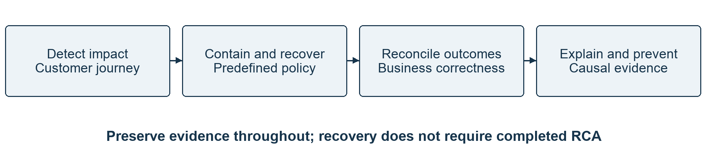

Figure 25. Proposed incident workflow. Customer recovery, business reconciliation, and causal explanation are separate outcomes, with evidence preserved throughout.

**1 Establish customer impact.** Identify the failing business capability, affected customer cohorts, and regional pattern. Compare external observation with local dashboards. Distinguish an unavailable endpoint from an incorrect business result.

**2 Preserve the change timeline.** Pause broad rollouts if indicated. Capture routing policy/state, health transitions, release/configuration revisions, connection settings, and worker ownership epochs before changing them.

**3 Trace one operation end to end.** Start with its stable business ID. Enumerate client and server attempts in every Region, including asynchronous descendants. Locate the durable outcome and any provider reference. Verify whether a timeout occurred before execution, during execution, or after a successful commit.

**4 Classify the failure boundary.** Separate ingress/DNS, application runtime, connection/TLS/authentication, database conflict, business rejection, queue/projection delay, and external effect. A retry that succeeds is useful recovery evidence; it does not establish the original cause.

**5 Contain and recover using the predefined policy.** Decide between regional evacuation, targeted endpoint fallback, disabling an optional capability, throttling a hot entity, or rolling back a change. Verify capacity and ownership before shifting work. Continue recording actions while recovery proceeds.

**6 Reconcile and establish cause.** Resolve unknown outcomes and incomplete workflows, then test the causal hypothesis against the sequence of evidence. For a database-internal impairment, retain sanitized timestamps, endpoint/Region, driver version, error codes, available AWS request identifiers, and representative operation histories for AWS Support. Your team can establish customer impact and the affected boundary while AWS investigates service internals.

**7 Restore the normal operating posture.** Reintroduce traffic gradually, confirm dependency and security readiness, and verify background backlog and stale workers. Convert the causal finding into a test or design change that prevents recurrence or limits impact.

## Architecture decision and implementation order

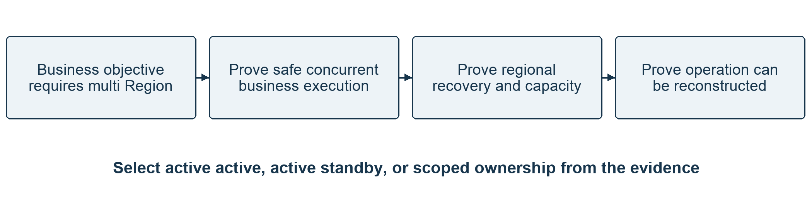

Figure 26. Proposed evidence path for selecting the application model. A multi-Region requirement does not by itself choose active-active application execution.

**Choose active-active applications** when the business needs faster regional recovery or geographic serving, and the team can demonstrate correct operation across retries, routing transitions, and concurrent execution. Aurora DSQL reduces an important obstacle; it does not select this operating model on the team's behalf.

**Choose active-standby applications** when tested recovery meets the business objective and a single normal serving path meaningfully simplifies operation. The same Aurora DSQL database can be used, so no traditional database promotion is necessarily required just because application traffic is active-standby. Standby capacity, drift, and failover still need testing.

**Use a hybrid execution model** when API serving benefits from multiple active Regions but irreversible background operations need clear ownership. Scope ownership to operations or entities and allow different owners in different Regions. Avoid introducing a global application leader unless its correctness and availability benefits justify the coordination cost.

| **Phase** | **Concrete output** | **Review owner** |
| --- | --- | --- |
| 1 Business requirements | Agreed customer RTO/RPO, latency, geography, invariants, and degraded functions | Business owner and architect |
| 2 Correctness design | Transaction boundaries, operation-key contract, workflow states, effect reconciliation, worker takeover protocol | Application engineering |
| 3 Regional recovery | Ingress policy, database endpoint policy, dependency map, capacity and quota evidence | Platform engineering and SRE |
| 4 Evidence and change safety | Operation timeline, telemetry coverage, mixed-version strategy, incident roles and runbook | Engineering and operations |
| 5 Comparative validation | Results of the same failure exercises for the candidate designs, with unresolved gaps | Architecture review and CTO |
| 6 Efficiency review | Cost/resource comparison at equal service objectives; retention and duplicate-work plan | Service owner and finance/operations |

**Decision record inputs.** Specify the selected Regions and service configuration, actual workload and contention profile, critical dependencies, allowable unknown-outcome duration, operator coverage, and external provider contracts. Revisit the decision when those inputs change.

**Acceptance statement.** Approve the design when customer service recovers within its objective, business correctness survives recovery, and a representative failed operation can be reconstructed. AWS guidance supports restoring service while the initial impairment is investigated. [\[S58\]](https://docs.aws.amazon.com/prescriptive-guidance/latest/aws-multi-region-fundamentals/fundamental-1.html) Compare recovery time and diagnosis effort separately; use the additional review on pages 40 to 44.

## AWS sources and documentation qualifications

The AWS references below support the Aurora DSQL edition. The diagrams explain the cited service behavior and our proposed controls; they are not AWS-certified reference architectures. Service guides establish product behavior, while blogs and Builders' Library articles supply implementation patterns. Reviewed on 14 November 2026.

**\[S01\]** [AWS Well Architected Framework definitions](https://docs.aws.amazon.com/wellarchitected/latest/framework/definitions.html)

**\[S02\]** [Resilience in Amazon Aurora DSQL](https://docs.aws.amazon.com/aurora-dsql/latest/userguide/disaster-recovery-resiliency.html)

**\[S04\]** [Concurrency control in Aurora DSQL](https://docs.aws.amazon.com/aurora-dsql/latest/userguide/working-with-concurrency-control.html)

**\[S05\]** [Troubleshooting issues in Aurora DSQL](https://docs.aws.amazon.com/aurora-dsql/latest/userguide/troubleshooting.html)

**\[S07\]** [Best practices for Amazon Route 53 DNS](https://docs.aws.amazon.com/Route53/latest/DeveloperGuide/best-practices-dns.html)

**\[S08\]** [How Route 53 chooses records when health checking is configured](https://docs.aws.amazon.com/Route53/latest/DeveloperGuide/health-checks-how-route-53-chooses-records.html)

**\[S09\]** [How AWS Global Accelerator works](https://docs.aws.amazon.com/global-accelerator/latest/dg/introduction-how-it-works.html)

**\[S10\]** [Routing control in Amazon Application Recovery Controller](https://docs.aws.amazon.com/r53recovery/latest/dg/routing-control.html)

**\[S11\]** [Implement multi Region endpoint routing for Aurora DSQL](https://aws.amazon.com/blogs/database/implement-multi-region-endpoint-routing-for-amazon-aurora-dsql/)

**\[S12\]** [Multi Region fundamentals understanding workload dependencies](https://docs.aws.amazon.com/prescriptive-guidance/latest/aws-multi-region-fundamentals/fundamental-3.html)

**\[S13\]** [Multi Region fundamentals operational readiness](https://docs.aws.amazon.com/prescriptive-guidance/latest/aws-multi-region-fundamentals/fundamental-4.html)

**\[S14\]** [OPS04 BP05 Implement distributed tracing](https://docs.aws.amazon.com/wellarchitected/latest/framework/ops_observability_dist_trace.html)

**\[S15\]** [Timeouts retries and backoff with jitter](https://aws.amazon.com/builders-library/timeouts-retries-and-backoff-with-jitter/)

**\[S16\]** [Transactional outbox pattern](https://docs.aws.amazon.com/prescriptive-guidance/latest/cloud-design-patterns/transactional-outbox.html)

**\[S17\]** [Leader election in distributed systems](https://aws.amazon.com/builders-library/leader-election-in-distributed-systems/)

**\[S18\]** [Caching challenges and strategies](https://aws.amazon.com/builders-library/caching-challenges-and-strategies/)

**\[S19\]** [Automating safe hands off deployments](https://aws.amazon.com/builders-library/automating-safe-hands-off-deployments/)

**\[S20\]** [Replicate Secrets Manager secrets across Regions](https://docs.aws.amazon.com/secretsmanager/latest/userguide/replicate-secrets.html)

**\[S21\]** [Authentication and authorization for Aurora DSQL](https://docs.aws.amazon.com/aurora-dsql/latest/userguide/authentication-authorization.html)

**\[S22\]** [Protecting data in transit](https://docs.aws.amazon.com/wellarchitected/latest/security-pillar/protecting-data-in-transit.html)

**\[S23\]** [Cost Optimization Pillar](https://docs.aws.amazon.com/wellarchitected/latest/cost-optimization-pillar/welcome.html)

**\[S24\]** [Design principles for sustainability in the cloud](https://docs.aws.amazon.com/wellarchitected/latest/sustainability-pillar/design-principles-for-sustainability-in-the-cloud.html)

**\[S25\]** [Sustainability data management](https://docs.aws.amazon.com/wellarchitected/latest/sustainability-pillar/data.html)

**\[S28\]** [Aurora DSQL connections drivers strings and best practices](https://aws.amazon.com/blogs/database/amazon-aurora-dsql-connections-drivers-strings-and-best-practices/)

**\[S29\]** [AWS Well Architected failure management](https://docs.aws.amazon.com/wellarchitected/latest/framework/rel-failmgmt.html)

**\[S30\]** [Considerations for working with Aurora DSQL](https://docs.aws.amazon.com/aurora-dsql/latest/userguide/considerations.html)

**\[S31\]** [Aurora DSQL cluster quotas and database limits](https://docs.aws.amazon.com/aurora-dsql/latest/userguide/CHAP_quotas.html)

**\[S32\]** [Generating an authentication token in Aurora DSQL](https://docs.aws.amazon.com/aurora-dsql/latest/userguide/SECTION_authentication-token.html)

**\[S33\]** [Getting started with Aurora DSQL multi Region clusters](https://docs.aws.amazon.com/aurora-dsql/latest/userguide/getting-started.html)

## Public papers for the architecture discussion

Start with AWS guidance for the operating-model decision. Use DSQL and other database research for architecture rationale, and tracing and failure-behavior papers for the CTO's RCA concern. These references supplement the service documentation; they do not extend Aurora DSQL guarantees.

| **Reading** | **Publication type** | **Question it helps answer** |
| --- | --- | --- |
| AWS multi-Region fundamentals [\[S36\]](https://docs.aws.amazon.com/pdfs/prescriptive-guidance/latest/aws-multi-region-fundamentals/aws-multi-region-fundamentals.pdf) | AWS guide | Requirements, data, dependencies, and operational readiness; applied on pages 40 to 44. |
| Disaster Recovery of Workloads on AWS [\[S37\]](https://docs.aws.amazon.com/whitepapers/latest/disaster-recovery-workloads-on-aws/disaster-recovery-options-in-the-cloud.html) | AWS whitepaper | Which standby or active-active strategy fits the recovery objective? |
| Aurora DSQL: Scalable, Multi-Region OLTP [\[S38\]](https://arxiv.org/abs/2607.13276) | 2026 arXiv preprint | How does DSQL separate execution, storage, and commit coordination? |
| Spanner: Google's Globally-Distributed Database [\[S39\]](https://research.google/pubs/spanner-googles-globally-distributed-database-2/) | OSDI 2012 research | How can synchronous geographic replication support distributed transactions? |
| Coordination Avoidance in Database Systems [\[S40\]](https://www.vldb.org/pvldb/vol8/p185-bailis.pdf) | PVLDB 2014 research | Which application invariants require coordination for correctness? |
| Dapper, a Large-Scale Distributed Systems Tracing Infrastructure [\[S41\]](https://research.google/pubs/dapper-a-large-scale-distributed-systems-tracing-infrastructure/) | Google technical report 2010 | How do tracing, sampling, and instrumentation support distributed diagnosis? |
| Metastable Failures in Distributed Systems [\[S42\]](https://sigops.org/s/conferences/hotos/2021/papers/hotos21-s11-bronson.pdf) | HotOS 2021 research | Why can work amplification sustain failure after its initial trigger disappears? |

### Reading path for the CTO

AWS fundamentals and disaster recovery explain the architecture choice. Dapper and Metastable Failures explain two different diagnostic challenges: reconstructing a request path and understanding a failure-sustaining feedback loop. The DSQL preprint is the closest technical match to the database under consideration.

### How to use the research safely

Transfer the reasoning and experimental method, then validate the actual service contract and workload. For example, Spanner's transaction guarantees do not establish equivalent semantics for Aurora DSQL. A paper's benchmark is not a measured result for this application.

## Availability commitments and observed customer outcomes

**Finding.** AWS service SLAs are contractual commitments with defined scope and remedies. Observed availability is an empirical result for a particular function, population, path, and period. Neither a service SLA nor a successful recovery drill establishes the monthly availability of this application. [\[S43\]](https://aws.amazon.com/rds/aurora/dsql/sla/) [\[S44\]](https://aws.amazon.com/route53/sla/) [\[S47\]](https://docs.aws.amazon.com/wellarchitected/latest/framework/rel_withstand_component_failures_service_level_agreements.html)

![Three availability views. Compare an observed SLI with the customer SLO; use each AWS SLA as a separately scoped contractual input. \[S49\]](aws_aurora_dsql_architecture_and_availability_report_assets/figure-27.png)

Figure 27. Three availability views. Compare an observed SLI with the customer SLO; use each AWS SLA as a separately scoped contractual input. [\[S49\]](https://docs.aws.amazon.com/AmazonCloudWatch/latest/monitoring/CloudWatch-ServiceLevelObjectives.html)

| **View** | **What it answers** | **Evidence required** |
| --- | --- | --- |
| AWS service SLA | When does the specified service qualify for a remedy? | Applicable configuration, outage rule, exclusions, billing cycle, and logs |
| Application SLO | What customer experience must the team achieve? | Agreed operation, deadline, correctness rule, population, and target |
| Measured availability SLI | What share of eligible operations actually succeeded? | Observed outcomes and denominator, with coverage and missing-data reporting |
| Architecture model | What could improve resilience under stated assumptions? | Dependency structure, common causes, routing behavior, and measured inputs |

**Relationship.** Realized availability can be above or below an SLA threshold. A credit compensates according to the service agreement; it does not restore a transaction, recover lost sales, or validate the application SLO. A high service commitment is useful procurement evidence, but architecture selection also needs measured customer outcomes. [\[S44\]](https://aws.amazon.com/route53/sla/) [\[S45\]](https://aws.amazon.com/global-accelerator/sla/) [\[S47\]](https://docs.aws.amazon.com/wellarchitected/latest/framework/rel_withstand_component_failures_service_level_agreements.html)

**Decision implication.** Compare active-active and active-standby using the same business success definition and observation window. Track regional and customer-cohort results alongside the global result so a healthy Region cannot hide another cohort's outage.

## Selected AWS SLAs and their measurement boundaries

Selected services relevant to a DSQL application, reviewed on 14 November 2026. Values are service commitments, not measured uptime. The table summarizes scope; the linked agreements contain the governing definitions and exclusions.

| **Service and configuration** | **Monthly commitment** | **Scope that matters** |
| --- | --- | --- |
| Aurora DSQL Single Region [\[S43\]](https://aws.amazon.com/rds/aurora/dsql/sla/) | 99.99% | Qualifying cluster unavailability; see the next page. |
| Aurora DSQL Multi Region [\[S43\]](https://aws.amazon.com/rds/aurora/dsql/sla/) | 99.999% | Peered-cluster coverage and eligibility conditions; see the next page. |
| Route 53 authoritative DNS [\[S44\]](https://aws.amazon.com/route53/sla/) | 100% commercial; 99.995% GovCloud | Hosted-zone DNS responses. API and console availability are excluded. |
| Global Accelerator [\[S45\]](https://aws.amazon.com/global-accelerator/sla/) | 99.99% Multi AZ; 99.5% Single AZ | Endpoint AZ placement determines the tier. A qualifying outage requires failed connectivity via the allocated IPs while healthy endpoint conditions hold. |
| EC2 [\[S55\]](https://aws.amazon.com/compute/sla/) | 99.99% Region level; 99.5% instance level | Region tier requires qualifying distribution across AZs; its outage rule concerns concurrent loss of external connectivity for all qualifying running instances. |
| Elastic Load Balancing [\[S56\]](https://aws.amazon.com/elasticloadbalancing/sla/) | 99.99% Multi AZ; 99.9% single AZ | The qualifying connectivity failure is conditional on at least one healthy target. Multi-AZ placement determines the tier. |

**Routing example.** A Route 53 hosted zone counts as unavailable only when all four assigned virtual name servers fail to answer all queries throughout a minute. DNS resolution success does not prove that the returned application path works. Preconfigured routing and application admission remain necessary. [\[S44\]](https://aws.amazon.com/route53/sla/)

**Architecture inference.** A healthy load-balancer health target or accelerator endpoint is a contractual prerequisite, not proof that a payment, order, or other customer operation succeeds. Test the full journey and preserve component checks for diagnosis. [\[S45\]](https://aws.amazon.com/global-accelerator/sla/) [\[S56\]](https://aws.amazon.com/elasticloadbalancing/sla/)

The selected compute and load-balancing rows are examples, not an assumption that this application uses those products. Add the actual identity, queue, storage, and third-party dependencies to the architecture inventory before evaluating the complete stack.

## DSQL SLA coverage and application recovery

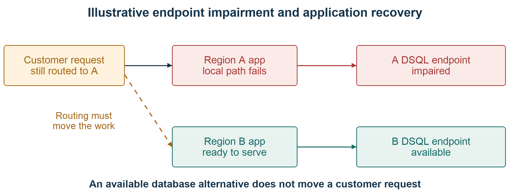

Figure 28. Illustrative failure path. Customer requests can fail while an alternate database endpoint remains available. This is a reasoning example, not an observed AWS outage.

| **Contract rule** | **Relevant DSQL definition** |
| --- | --- |
| Multi Region coverage | Only minutes when all active peered Regions are unavailable reduce the multi-Region monthly percentage. |
| Eligibility | The cluster must remain multi-Region throughout the billing cycle, with reasonable efforts to use available peer clusters during a regional impairment. |
| Qualifying minute | At least 60 requests; all connection requests fail and/or all PostgreSQL transaction requests fail with Internal Error XX000. |
| Low traffic and exclusions | Minutes below 60 requests count as available. Exclusions include customer software, external network factors, and Idle or Inactive clusters. |

These are abbreviated contract definitions. [\[S43\]](https://aws.amazon.com/rds/aurora/dsql/sla/)

**Architecture inference.** Multi-Region database coverage does not require every application Region to serve continuously. Active-standby applications can use a peered database if their recovery behavior satisfies the contract conditions. Neither application model receives automatic customer routing or connection migration from the SLA.

**Operational consequence.** Maintain two records: customer-visible failure and contractual evidence. Capture selected endpoint, Region, connection versus transaction failure, error code, per-minute request count, and attempts to reach the alternate endpoint. A 40001 conflict, a slow successful call, and XX000 are different diagnostic outcomes. [\[S04\]](https://docs.aws.amazon.com/aurora-dsql/latest/userguide/working-with-concurrency-control.html) [\[S43\]](https://aws.amazon.com/rds/aurora/dsql/sla/)

## Availability arithmetic and incompatible denominators

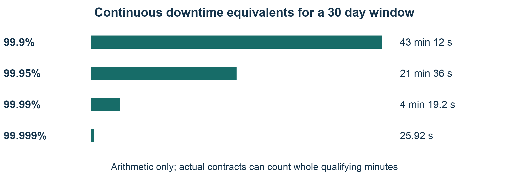

Figure 29. Calculated equivalents: (1 minus target) times 30 days. These values are neither measured downtime nor a substitute for service-specific outage counting.

**Billing window matters.** For a complete 30-day month, one qualifying unavailable minute gives 99.997685%. This is already below a 99.999% threshold. A 25.92-second continuous equivalent does not change a contract that evaluates one-minute intervals. Annual equivalents cannot be pooled across independently evaluated billing months. [\[S43\]](https://aws.amazon.com/rds/aurora/dsql/sla/)

### Two minute illustrative example

| **Minute** | **Good requests** | **Valid requests** | **Success share** |
| --- | --- | --- | --- |
| Quiet minute | 100 | 100 | 100% |
| Busy minute | 5,000 | 10,000 | 50% |

**Request-weighted result:** 5,100 / 10,100 = 50.495%. **Equal-minute mean:** (100% + 50%) / 2 = 75%. **Period SLO:** if a healthy minute requires at least 99% success, 1 of 2 minutes is healthy, giving 50% period attainment. All three calculations use the same illustrative events and answer different questions. [\[S49\]](https://docs.aws.amazon.com/AmazonCloudWatch/latest/monitoring/CloudWatch-ServiceLevelObjectives.html)

Retries also change the denominator. Measure one customer operation once for its final outcome and deadline; retain attempt success and retry volume separately. Define expected business rejections and eligible requests in advance. Keep maintenance and client-path interruptions visible in the customer SLI even where a supplier contract excludes them. [\[S46\]](https://docs.aws.amazon.com/wellarchitected/latest/reliability-pillar/availability.html)

## Public measured evidence and its practical limits

![Reported measurement from ROBOCO E006, 29 September 2026. The 79.4% success share is calculated from the rounded 20.6% technical failure rate. Client-side fault injection does not establish an AWS SLA violation. \[S54\]](aws_aurora_dsql_architecture_and_availability_report_assets/figure-30.png)

Figure 30. Reported measurement from ROBOCO E006, 29 September 2026. The 79.4% success share is calculated from the rounded 20.6% technical failure rate. Client-side fault injection does not establish an AWS SLA violation. [\[S54\]](https://roboco.io/dsql-experiments/#published-results)

| **Public evidence** | **Measured scope and finding** | **What it establishes** |
| --- | --- | --- |
| DSQL E006 experiment [\[S54\]](https://roboco.io/dsql-experiments/#published-results) | One Single Region deployment; 150 seconds with a 30-second deliberate client-path block. Technical failures 20.6%; no lost or duplicated committed effects reported. | Availability of this client path and recovery design during this test. It does not measure DSQL internal or regional failover, or long-term production uptime. |
| Hu and colleagues PAM 2014 [\[S51\]](https://ant.isi.edu/~johnh/PAPERS/Hu14b.pdf) | 2013 EC2 and cloud-storage probes from multiple locations found ICMP and HTTP could disagree about outages. | Measurement protocol and vantage point affect the result. Historical tests cannot estimate current DSQL availability. |
| Cloud Uptime Archive 2025 preprint [\[S53\]](https://arxiv.org/html/2504.09476v1) | Collected operator and user reports. Cloud operator data spans April 2019 to September 2024; reported failures differ by viewpoint. | A useful source of historical incident scenarios. Reports do not provide this application's request denominator or a DSQL production-uptime series. |

**Evidence conclusion.** The public results above support measurement design and fault scenarios. They cannot supply a defensible observed monthly availability percentage for the proposed multi-Region DSQL deployment. That percentage remains an application measurement to collect. Availability claims must state the deployment, dates, workload, observer locations, retries, denominator, and fault conditions.

AWS Health distinguishes public service events from account-specific resource events. Use both for correlation; counting public incident durations alone cannot reconstruct customer request success. [\[S48\]](https://docs.aws.amazon.com/health/latest/ug/about-public-events.html)

## How active active and standby change availability

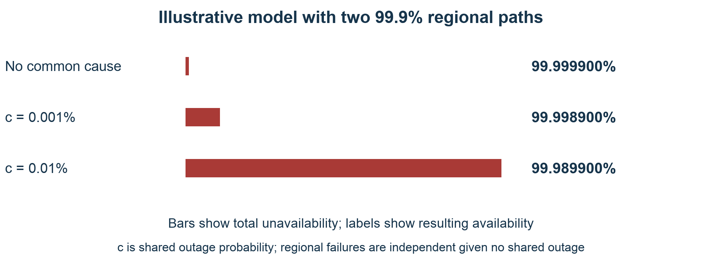

Figure 31. Calculated sensitivity example, not an AWS forecast. q = 0.001 is each regional path's failure probability conditional on no shared outage; c is a shared-outage probability. No SLA percentage is used as an empirical input.

**Model boundaries.** For independent hard dependencies, a series model multiplies availability. For independent redundant paths with immediate successful selection, availability is 1 minus the product of failure probabilities. AWS presents these as theoretical calculations. Correlated failures and recovery delay require additional terms. [\[S46\]](https://docs.aws.amazon.com/wellarchitected/latest/reliability-pillar/availability.html)

The plotted model is **A = (1 - c) x (1 - q squared)**. It assumes a shared outage disables both paths and that, otherwise, their failures are independent. Routing, common releases, identity, and shared external dependencies can create common causes. Treat DSQL peered endpoints as access paths to one managed service; do not infer their joint failure probability by squaring an SLA shortfall.

| **Application model** | **Potential availability benefit** | **Remaining evidence** |
| --- | --- | --- |
| Active active | Both application paths already serve work; surviving capacity can reduce recovery delay. | Failed-path traffic movement, request deadlines, correlated releases, correct retries, and useful surviving capacity. |
| Active standby | A simpler normal execution path can reduce some operational failure modes. | Detection, decision, routing, connection recovery, standby readiness, and validation delay. |
| Both | DSQL can support the chosen application model. | End-to-end loss during each failure and recovery; logical correctness; investigation time. |

Compare lost customer operations and time to sustained recovery in matched exercises. An active-active design with faulty routing can underperform a rehearsed standby. Fault-test results reveal recovery mechanics; they do not establish incident frequency or long-run availability.

## A measurement plan for the DSQL application

![Proposed evidence architecture. Customer outcomes, contractual reconstruction, and RCA use correlated records with distinct definitions. CloudWatch supports SLOs and synthetic checks. \[S49\] \[S50\]](aws_aurora_dsql_architecture_and_availability_report_assets/figure-32.png)

Figure 32. Proposed evidence architecture. Customer outcomes, contractual reconstruction, and RCA use correlated records with distinct definitions. CloudWatch supports SLOs and synthetic checks. [\[S49\]](https://docs.aws.amazon.com/AmazonCloudWatch/latest/monitoring/CloudWatch-ServiceLevelObjectives.html) [\[S50\]](https://docs.aws.amazon.com/AmazonCloudWatch/latest/monitoring/CloudWatch_Synthetics_Canaries.html)

| **Measurement** | **Proposed definition and collection** |
| --- | --- |
| Primary customer SLI | Correct logical operations completed by their deadline / all eligible logical operations. Retain original operation identity across retries. |
| Regional and cohort SLIs | Break down by serving Region, customer geography, tenant class, read/write operation, and ingress path. Fix aggregation rules before comparing models. |
| First attempt and final outcome | Record first-attempt errors, recovered operations, final failures, latency, duplicate effects, and unresolved outcomes separately. |
| Coverage | Retain traffic and probe counts, collector health, missed runs, and expected-versus-received records. Missing telemetry is unknown; report its share. |
| Contract and RCA evidence | Preserve per-minute component records, sanitized request errors, routing changes, deployments, endpoint selection, and AWS Health events. |

CloudWatch Application Signals' default Availability metric treats non-5xx responses, including 4xx, as successful. A 200 response with incorrect business state can also escape this technical metric. Use custom outcome metrics where the business SLI needs richer semantics. [\[S49\]](https://docs.aws.amazon.com/AmazonCloudWatch/latest/monitoring/CloudWatch-ServiceLevelObjectives.html)

CloudWatch Synthetics can run as often as once per minute. Supplement it with production outcome counters and, where justified, dedicated finer-resolution probes from independent failure domains. A single short outage can fall between scheduled checks; record probe failures and observer failures separately. [\[S50\]](https://docs.aws.amazon.com/AmazonCloudWatch/latest/monitoring/CloudWatch_Synthetics_Canaries.html) [\[S52\]](https://arxiv.org/abs/1408.0510)

## Evidence strength and the CTO decision

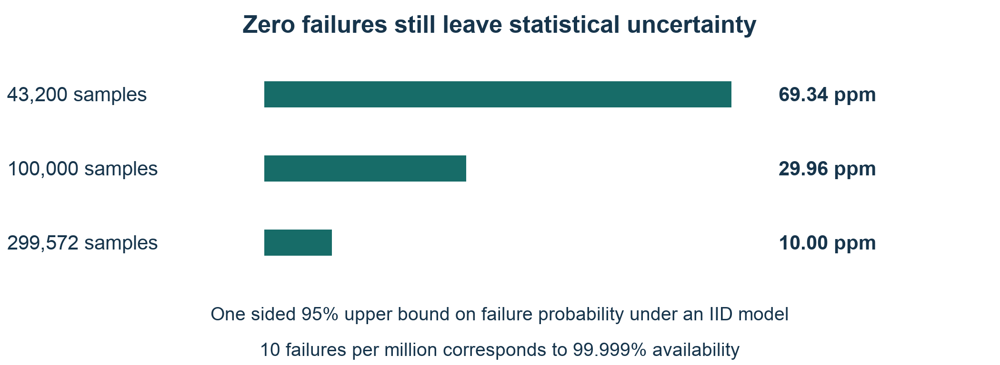

Figure 33. Calculated statistical illustration. With zero observed failures, p upper = 1 - 0.05 raised to (1/N). Assumes independent, identically distributed Bernoulli samples; real outages are often correlated.

At one observation per minute, 30 days yields 43,200 samples. With zero failures, the model's one-sided 95% lower bound on availability is about **99.993066%**, which does not establish 99.999%. Approximately **299,572 independent zero-failure samples** are required for that particular bound. These are mathematical results, not a proposed duration for proving AWS SLA compliance.

The IID assumption is usually too strong for outage evidence: a single regional incident can generate thousands of correlated failures, and several nearby probes can share one network path. Preserve incident clustering, customer coverage, and regional dependence when analyzing confidence. Low-frequency probing also misses short interruptions. [\[S51\]](https://ant.isi.edu/~johnh/PAPERS/Hu14b.pdf) [\[S52\]](https://arxiv.org/abs/1408.0510)

| **Decision evidence** | **How to use it** |
| --- | --- |
| Applicable AWS SLA | Record the service tier, eligibility, counting rule, exclusions, and claim evidence. It is the contractual baseline. |
| Continuous customer SLIs | Use representative traffic and explicit coverage to compare observed performance against the customer SLO. Review both calendar and rolling windows. |
| Failure and recovery exercises | Compare customer loss, sustained recovery, correctness, and investigation time for both operating models. Include a failed central collector. |
| CTO review | Require an unfamiliar responder to reconstruct one failed operation across routing, endpoint changes, retries, and effects. Track time to recovery separately from time to establish cause. |

**Recommendation.** Choose the least complex application model that meets the measured customer recovery and correctness objectives. Treat service SLAs, observed uptime, and exercise results as complementary evidence. Do not claim five-nines application availability from a database SLA, an incident count, or a short successful pilot. [\[S47\]](https://docs.aws.amazon.com/wellarchitected/latest/framework/rel_withstand_component_failures_service_level_agreements.html)

## Sources for SLA and measured availability analysis

**Primary service agreements, AWS documentation, original research, and a published experiment.** Accessed 14 November 2026. Calculated examples and proposed controls are labeled in the text. Earlier architecture references remain on pages 29 and 30. Additional strategy sources and qualifications are on page 44.

**\[S43\]** [Amazon Aurora DSQL Service Level Agreement](https://aws.amazon.com/rds/aurora/dsql/sla/)

**\[S44\]** [Amazon Route 53 Service Level Agreement](https://aws.amazon.com/route53/sla/)

**\[S45\]** [AWS Global Accelerator Service Level Agreement](https://aws.amazon.com/global-accelerator/sla/)

**\[S46\]** [AWS Reliability Pillar Availability and dependency calculations](https://docs.aws.amazon.com/wellarchitected/latest/reliability-pillar/availability.html)

**\[S47\]** [REL11 BP07 Architect for availability targets and SLAs](https://docs.aws.amazon.com/wellarchitected/latest/framework/rel_withstand_component_failures_service_level_agreements.html)

**\[S48\]** [AWS Health Public and account specific events](https://docs.aws.amazon.com/health/latest/ug/about-public-events.html)

**\[S49\]** [CloudWatch Service level objectives and SLI definitions](https://docs.aws.amazon.com/AmazonCloudWatch/latest/monitoring/CloudWatch-ServiceLevelObjectives.html)

**\[S50\]** [CloudWatch Synthetics canaries](https://docs.aws.amazon.com/AmazonCloudWatch/latest/monitoring/CloudWatch_Synthetics_Canaries.html)

**\[S51\]** [Hu and colleagues End to End Evaluation of Cloud Availability PAM 2014](https://ant.isi.edu/~johnh/PAPERS/Hu14b.pdf)

**\[S52\]** [Naldi Measurement frequency and retry critique 2014 preprint](https://arxiv.org/abs/1408.0510)

**\[S53\]** [Cloud Uptime Archive 2025 preprint and public dataset analysis](https://arxiv.org/html/2504.09476v1)

**\[S54\]** [ROBOCO DSQL Experiment Notes E006 measured client network interruption](https://roboco.io/dsql-experiments/#published-results)

**\[S55\]** [Amazon Compute Service Level Agreement](https://aws.amazon.com/compute/sla/)

**\[S56\]** [Amazon Elastic Load Balancing Service Level Agreement](https://aws.amazon.com/elasticloadbalancing/sla/)

## AWS active active strategy and write placement

**Finding.** The AWS active-active article describes multiple regional stacks serving production traffic. It separates traffic routing from three write-placement patterns: local, global, and partitioned. [\[S57\]](https://aws.amazon.com/blogs/architecture/disaster-recovery-dr-architecture-on-aws-part-iv-multi-site-active-active/)

![Application write-placement alternatives from the AWS strategy article, adapted to DSQL. The arrows show application ownership and forwarding, not the database replication protocol. \[S57\] \[S02\]](aws_aurora_dsql_architecture_and_availability_report_assets/figure-34.png)

Figure 34. Application write-placement alternatives from the AWS strategy article, adapted to DSQL. The arrows show application ownership and forwarding, not the database replication protocol. [\[S57\]](https://aws.amazon.com/blogs/architecture/disaster-recovery-dr-architecture-on-aws-part-iv-multi-site-active-active/) [\[S02\]](https://docs.aws.amazon.com/aurora-dsql/latest/userguide/disaster-recovery-resiliency.html)

| **Application pattern** | **DSQL application interpretation** | **Recovery design to prove** |
| --- | --- | --- |
| Write local | Either application Region submits reads and writes to its local DSQL endpoint. | Safe concurrent commands, unknown outcomes, and destination capacity. |
| Write global | Both Regions may serve APIs; application policy sends writes to one owner. | Transfer application write ownership and its routing when required. |
| Write partitioned | Each tenant or entity has an application home Region; both Regions own different cohorts. | Transfer the affected cohort and reject stale owners or duplicate effects. |

**DSQL boundary.** Both serving endpoints remain read and write capable; these are application policy choices. DSQL automates cluster recovery, so a single application writer does not create a traditional primary-secondary database promotion step. [\[S02\]](https://docs.aws.amazon.com/aurora-dsql/latest/userguide/disaster-recovery-resiliency.html) The ownership checks in the table are proposed controls, developed in R3 to R6.

**Recovery objective.** The article associates local writes with the fastest recovery potential, but its near-zero language is not an end-to-end RTO guarantee. User routing, reconnection, backlog, and effects still need measurement. [\[S57\]](https://aws.amazon.com/blogs/architecture/disaster-recovery-dr-architecture-on-aws-part-iv-multi-site-active-active/)

**Requirements first.** AWS fundamentals calls for workload-specific availability, RTO, and RPO aligned with business owners. [\[S58\]](https://docs.aws.amazon.com/prescriptive-guidance/latest/aws-multi-region-fundamentals/fundamental-1.html) Compare the three patterns and standby against the same customer objectives, including acceptable degraded functions and time to reconcile effects.

**Source qualification.** The 2021 article predates DSQL. Its database examples do not define DSQL semantics. The comparison above is an application design interpretation, not an AWS DSQL reference architecture.

## Regional routing and recovery dependencies

**Conclusion.** The unit of regional recovery should be a customer capability with a usable dependency path. Moving ingress to Region B succeeds only when B can authenticate the caller, execute the business transition, handle asynchronous work, and establish the intended outcome. An available DSQL endpoint resolves one part of this path.

This section proposes a design for two application Regions using multi-Region Aurora DSQL. It applies AWS guidance on regional isolation and coordinated user journeys. The inventories, decision rules, and exercises below are proposed controls for this application; they are not AWS service guarantees. [\[S12\]](https://docs.aws.amazon.com/prescriptive-guidance/latest/aws-multi-region-fundamentals/fundamental-3.html) [\[S60\]](https://aws.amazon.com/blogs/architecture/creating-an-organizational-multi-region-failover-strategy/)

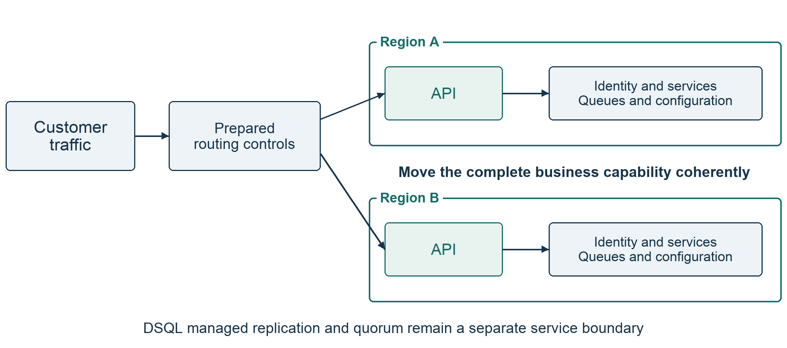

Figure 35. Overview retained from the earlier report. The detailed design below includes ingress, internal calls, database access, and work ownership.

### Four routing decisions that need separate policies

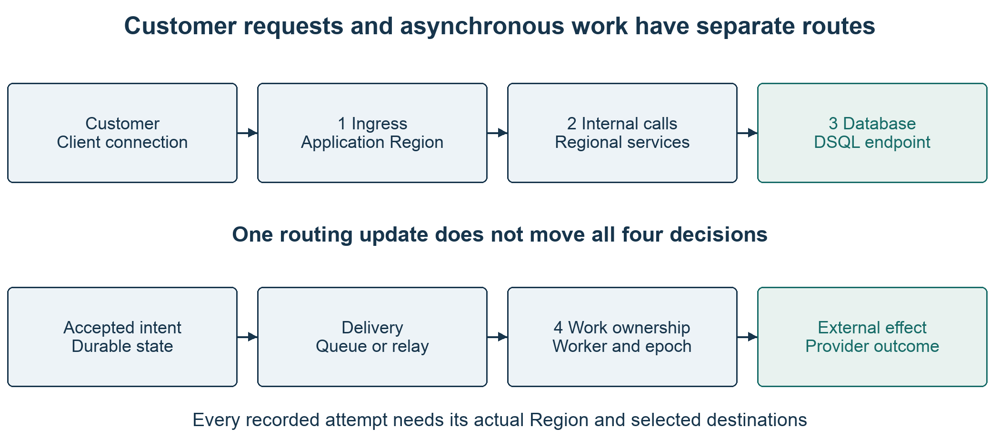

Routing diagram 1. Each arrow represents a decision that must be observable. Changing one decision does not automatically change the others.

| Decision | What is selected | Failure that remains possible | Proposed policy owner |
| --- | --- | --- | --- |
| Customer ingress | Application Region for a new client connection or request | Cached DNS or a reused connection still reaches the impaired Region | Platform owner for the customer capability |
| Internal service calls | Regional identity, order, inventory, and other dependency endpoints | An API in B calls a required service in A | Owners of the dependency graph |
| Database access | DSQL serving endpoint and connection pool | App B selects endpoint A, or creates a new connection with incorrect endpoint identity | Application database-access owner |
| Asynchronous execution | Queue, consumer, scheduler, callback destination, and operation owner | Old and replacement workers both attempt an effect | Workflow owner with a tested takeover protocol |

Recovery controls form a separate operational path. Operators need access to the routing mechanism, its configuration, credentials, and evidence during the failure. This path must not require a functioning application stack in the Region being evacuated. [\[S12\]](https://docs.aws.amazon.com/prescriptive-guidance/latest/aws-multi-region-fundamentals/fundamental-3.html)

For example, a successful DNS change does not move an existing database connection, copy queued work, or stop a previously running worker. Record which of these decisions changed during every exercise.

### Build the recovery boundary from the dependency graph

Start with one named operation, such as accepting an order, rather than a list of AWS resources. Follow its required calls, state reads, asynchronous consequences, and recovery tools. AWS describes how shared dependencies can join otherwise separate recovery graphs; regional replicas of a shared application can reduce that coupling where feasible. [\[S60\]](https://aws.amazon.com/blogs/architecture/creating-an-organizational-multi-region-failover-strategy/)

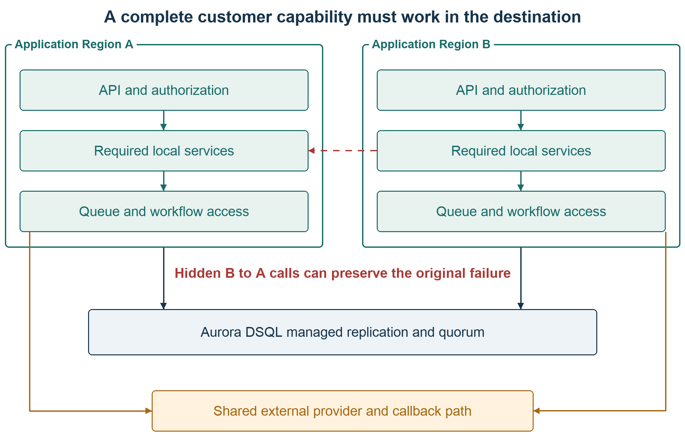

Routing diagram 2. A hidden call from B to A can preserve the original failure after ingress has moved. DSQL managed coordination and a shared provider are explicit service dependencies, with their own failure assumptions.

Use the following inventory for each critical capability. The examples are illustrative, not an assertion that this workload uses every listed component.

| Dependency | Question that defines the recovery boundary | Evidence to retain before an incident |
| --- | --- | --- |
| Identity and authorization | Can B validate the caller and enforce current permissions if the identity path in A is unavailable? | Tested identity path, allowed cache behavior, key freshness, and denial behavior |
| Required internal services | Are all mandatory calls available within B, or is a degraded outcome explicitly supported? | Actual destination Region and service version for each critical call |
| Regional configuration and artifacts | Can B start and continue operating without fetching configuration or images through A? | Local artifact digests, configuration revisions, refresh behavior, and expiration dates |
| DSQL access | Can B connect to the intended serving endpoint and execute the required transaction? | Endpoint, principal, TLS validation, pool limits, transaction class, and error classification |
| Queues and derived state | Which accepted work is still in A, and what can be reconstructed from durable intent? | Queue age, durable event identities, relay checkpoints, replay rules, and projection versions |
| External providers and callbacks | Does the provider work from B, and where will delayed responses or callbacks arrive? | Tested destination, stable provider operation key, callback path, and reconciliation procedure |
| Recovery and telemetry | Can responders make a decision and execute recovery if A or the central collector fails? | Accessible regional views, recovery endpoints, permissions, runbook, and missing-data indicators |

Classify each dependency as **required for acceptance**, **required for later completion**, or **optional**. A failed recommendation service might permit order acceptance without recommendations. An unavailable authorization service generally cannot be bypassed safely. The business owner must approve each degraded behavior in advance.

Dependency discovery should include infrequent paths: first login after key rotation, cache misses, certificate renewal, deployment rollback, account recovery, batch reconciliation, and provider callbacks. A successful warm-cache request does not validate those paths.

### Choose how much of the graph moves together

AWS identifies four recovery scopes. Its discussion highlights a trade-off between independent component recovery and the number of mixed regional configurations that must be tested. [\[S60\]](https://aws.amazon.com/blogs/architecture/creating-an-organizational-multi-region-failover-strategy/)

| Recovery scope | Benefit | Main difficulty | Proposed use in this design |
| --- | --- | --- | --- |
| Component | A narrow impairment may be bypassed without moving the application | Additional latency, state differences, and many possible combinations | A documented exception such as an isolated DSQL client-path impairment |
| Application | The application's components move together | Upstream and downstream applications may remain in the other Region | Suitable only when its external interfaces tolerate that placement |
| Dependency graph | The services needed for one customer capability recover coherently | Discovering shared and rarely used dependencies; coordinating owners | Preferred starting point for a critical customer journey |
| Portfolio or agreed tier | A broader estate moves together | Larger readiness investment and a broader consequence from a mistaken evacuation | Consider where shared dependencies make smaller boundaries impractical |

This is not a requirement to make one global switch for the entire company. The proposed boundary should be the smallest tested group that can provide a correct customer outcome without depending on the impaired application path.

For an active-active deployment, both Regions can already serve the capability. Evacuation removes the affected Region's share of work. The required coordination still includes admission, dependencies, connections, worker ownership, and pending effects.

### Understand what the routing mechanism actually controls

| Mechanism | Useful capability | Boundary responders must understand |
| --- | --- | --- |
| Route 53 latency routing | Selects a regional DNS answer using AWS latency data | The selection is not a measurement of that request's complete business latency. Resolver location and EDNS client-subnet information influence the decision. [\[S61\]](https://docs.aws.amazon.com/Route53/latest/DeveloperGuide/routing-policy-latency.html) |
| Route 53 health-based routing | Can return an alternative answer when configured checks fail | Health is evaluated periodically; DNS queries do not trigger a fresh application test. Record groups and alias health settings affect the result. [\[S08\]](https://docs.aws.amazon.com/Route53/latest/DeveloperGuide/health-checks-how-route-53-chooses-records.html) |
| Standard Global Accelerator | Directs new connections using endpoint health and routing configuration | Established connections do not migrate simply because a different endpoint is selected for new connections. It is application ingress, not a direct DSQL proxy. [\[S09\]](https://docs.aws.amazon.com/global-accelerator/latest/dg/introduction-how-it-works.html) |
| ARC routing control | Provides an operator-controlled switch integrated with Route 53 health checks | The switch does not itself test customer health, and DNS/client behavior still governs the traffic transition. [\[S64\]](https://docs.aws.amazon.com/r53recovery/latest/dg/routing-control.about.html) |
| Application endpoint selection | Can respond to a failure seen by that application | Requires a clear error policy, correct endpoint authentication, bounded reconnects, and safe handling of uncertain outcomes. [\[S11\]](https://aws.amazon.com/blogs/database/implement-multi-region-endpoint-routing-for-amazon-aurora-dsql/) |

**All-unhealthy behavior matters.** Route 53 can consider an all-unhealthy record group healthy for selection; with both checked primary and secondary failover records unhealthy, it returns the primary. A zero-weight record can also become eligible under documented conditions. [\[S08\]](https://docs.aws.amazon.com/Route53/latest/DeveloperGuide/health-checks-how-route-53-chooses-records.html)

Standard Global Accelerator can fail open, and its failover search can include endpoint groups whose traffic dial is zero. A zero traffic dial therefore does not enforce a strict location restriction. [\[S62\]](https://docs.aws.amazon.com/global-accelerator/latest/dg/about-endpoints-endpoint-weights.unhealthy-endpoints.html) Enforce permitted destinations and correctness in the application and relevant access policies. Test the exact configured routing tree rather than assuming every mechanism has the same fallback behavior.

### Design health checks for the decision they support

| Signal | What it establishes | What it should influence |
| --- | --- | --- |
| Process liveness | The process can respond to its local health test | Local replacement; avoid restarting a healthy fleet because one shared provider is down |
| Instance readiness | This instance is initialized and can accept its required work | Local admission and load-balancer membership |
| Forced regional journey | A bounded representative operation works when explicitly directed to A or B | Comparison of regional capability before an evacuation |
| Customer-path observation | Representative clients can resolve, connect, authenticate, and complete the operation | Customer impact by geography, network, tenant cohort, and operation |
| Recovery-path readiness | Destination permissions, dependencies, and useful capacity are usable | Whether moving more work is likely to help |
| Telemetry health | The observations themselves are fresh and complete enough | Confidence in the decision; missing data must remain visibly unknown |

An AWS gray-failure paper describes differential observability: different observers can see different failure behavior. Although that paper focuses on Availability Zones, the observation principle is useful here. A green infrastructure check and a failing customer write can both be accurate observations of different paths. [\[S65\]](https://docs.aws.amazon.com/pdfs/whitepapers/latest/advanced-multi-az-resilience-patterns/advanced-multi-az-resilience-patterns.pdf)

Run regional probes independently of global ingress, and also test the real global entry point. Otherwise, a global probe may repeatedly reach the healthy Region and conceal the other Region's failure. Use designated test data, bounded calls, and safe provider test paths for synthetic transactions.

Do not evacuate solely because an optional dependency failed in both Regions. That can add reconnects and retry traffic without removing the cause. For load-balancer endpoints behind Global Accelerator, review the load balancer's own health configuration; Global Accelerator's custom health-check settings do not govern those endpoints. [\[S74\]](https://docs.aws.amazon.com/global-accelerator/latest/dg/about-endpoint-groups-health-check-options.html)

### Match the action to the observed impairment

The following is a proposed decision matrix. It specifies hypotheses and required evidence, not automatic responses for every occurrence of an error.

| Observation | First evidence to check | Candidate action | Reason to stop or choose a narrower action |
| --- | --- | --- | --- |
| Most critical paths fail in A; B succeeds from independent observers | Regional journey results, recent changes, destination dependencies, and spare capacity | Evacuate the affected capability from A | B shares the same failing provider or cannot absorb the work |
| Only one application's path to DSQL A fails | DNS, TCP/TLS, principal, pool acquisition, and direct controlled endpoint tests | Repair the local path or use the approved peer-endpoint fallback | The error is authorization, contention, or an application bug rather than reachability |
| Both Regions fail after the same configuration change | Artifact and configuration versions by Region and the first failing operation | Contain or roll back that change | Moving traffic alone preserves the bad configuration |
| Only some client networks fail | Resolver answers, client connection age, network path, and actual serving Region | Address ingress/client-path failure | Healthy internal probes do not disprove the cohort's outage |
| One tenant or hot entity has repeated conflicts | Operation mix, entity contention, attempt count, and transaction errors | Reduce contention and bound retries | Broad evacuation may move the same contention to B |
| A shared external provider fails everywhere | Provider response, circuit state, pending intents, and permitted degradation | Degrade that capability or retain pending work | A regional move does not create a healthy provider |
| Queue processing stops while API acceptance works | Durable intent, oldest pending age, consumer ownership, and destination replay | Recover the processing path and reconcile pending work | Accepting new work indefinitely would break the completion objective |
| The central dashboard is unavailable | Regional metrics, external probes, collector state, and last known routing state | Use the prepared independent evidence path | Telemetry loss alone does not establish that customer service failed |

For DSQL specifically, AWS documents that a server-unavailable error can leave the connection active. If the error occurs during commit, the transaction may already have committed. Classify the failure before reconnecting or repeating a command. [\[S05\]](https://docs.aws.amazon.com/aurora-dsql/latest/userguide/troubleshooting.html)

**A peer-endpoint fallback exception should specify** the initiating error classes, destination endpoint, valid principal and TLS identity, latency budget, retry budget, maximum duration, and exit rule. It should also specify whether repeated failure triggers whole-journey evacuation. Prevent the endpoint client and ingress automation from independently sending the same work back and forth.

### Treat traffic movement as a transition

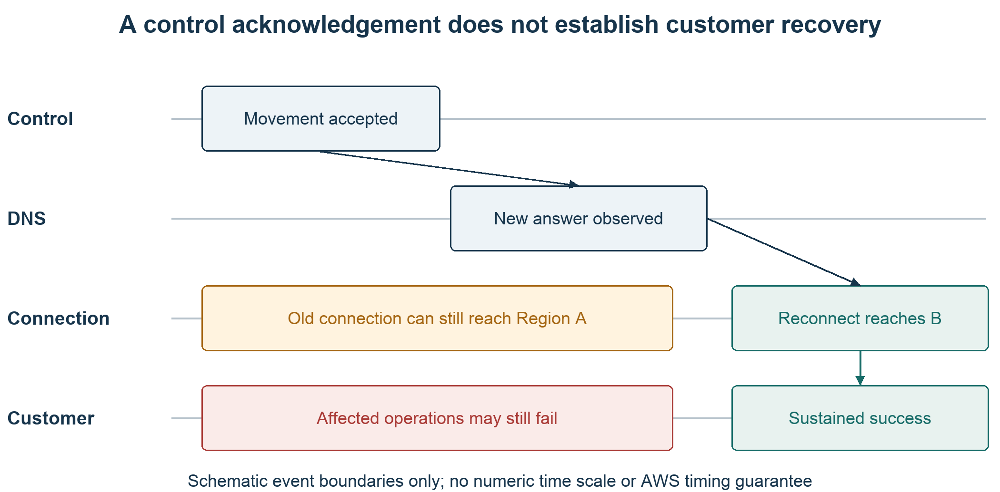

Routing diagram 3. A successful control action is one event in the recovery path. The lanes have no numeric time scale and are not an AWS timing guarantee.

Record at least five timestamps: impact begins, the movement decision is made, the control action is accepted, the destination receives successful production work, and the agreed customer success condition remains sustained. Also retain the time when the affected cohort's old-path traffic finally stops, if that is required.

DNS TTL influences cache refresh. It does not terminate a live HTTP/2, WebSocket, or database connection. AWS ARC guidance therefore also recommends limiting client connection duration and preparing local copies of its regional control endpoints. Use the ARC data-plane API with endpoint retry logic rather than discovering controls through the console during the impairment. [\[S63\]](https://docs.aws.amazon.com/r53recovery/latest/dg/route53-arc-best-practices.regional.html)

**Customer recovery duration** is the elapsed time from the defined first impact to sustained successful customer operations. Detection, decisions, routing visibility, reconnects, dependency recovery, and verification can overlap; the critical path determines the duration. Adding configured timer values does not establish a worst-case bound.

Measure the last affected cohorts as well as the median. A global success rate can improve quickly while clients with long-lived connections continue to fail. Establish a reconnect and retry policy that preserves operation identity and remains within the customer's deadline.

### Execute a controlled recovery sequence

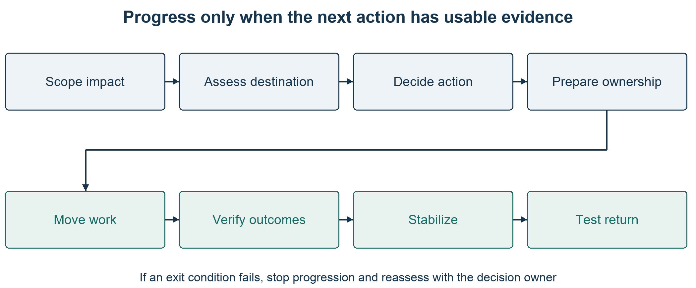

Routing diagram 4. Proposed incident states. Observation continues throughout; failure at an exit condition stops progression and returns the decision to the incident commander.

| Step | Action | Exit evidence |
| --- | --- | --- |
| Establish scope | Identify failed capabilities, cohorts, and regional paths; capture current configuration | A customer-impact statement and explicit unknowns |
| Assess destination | Test required dependencies, access, compatible versions, and useful capacity | B can perform the critical operation with the expected load and permissions |
| Decide scope | Choose targeted repair, approved endpoint fallback, capability evacuation, or degraded operation | One named decision owner and a recorded reason |
| Prepare work ownership | Apply the workflow's takeover, admission, or fencing rules where necessary | Stale executors cannot create unprotected duplicate effects; unknown effects are tracked |
| Move work | Execute the prepared routing operation and controlled connection recovery | Observed traffic movement and valid destination outcomes |
| Verify recovery | Check logical operations, deadlines, pending effects, queues, and cohorts | Sustained customer success and bounded backlog, not merely successful control-plane calls |
| Stabilize | Restrict unnecessary changes and manage catch-up work | Stable capacity, retry pressure, and ownership while diagnosis continues |
| Return gradually | Revalidate the original Region and restore work in tested increments | Each increment passes the same customer, correctness, and stability checks |

AWS fundamentals recommends named people decide broad regional failover activation and automate its execution. That organizational boundary can coexist with preconfigured health routing and automatic local recovery. The scope and authority of each mechanism must be explicit. [\[S13\]](https://docs.aws.amazon.com/prescriptive-guidance/latest/aws-multi-region-fundamentals/fundamental-4.html)

There is no universally safe ordering that stops all work in A before preparing B: an outage can prevent A from acknowledging a stop. Design takeover to tolerate an old worker continuing. Lease expiry or a routing update alone is not proof that the old process stopped; apply the ownership and external-effect controls in R5 and R6. [\[S17\]](https://aws.amazon.com/builders-library/leader-election-in-distributed-systems/)

### Size the surviving path for useful work and recovery work

**Illustrative arithmetic only.** Suppose A and B each accept 800 logical operations per second, with one database transaction per operation before retries. After evacuation, assume 1.25 transaction attempts per operation and 100 additional transactions per second for background catch-up.

| Quantity | Calculation | Illustrative result |
| --- | --- | --- |
| Customer operations reaching B | 800 + 800 | 1,600 operations/s |
| Foreground transaction attempts | 1,600 × 1.25 | 2,000 attempts/s |
| Total transaction traffic | 2,000 + 100 | 2,100 attempts/s |

The example is a workload calculation, not measured DSQL performance, a service quota, or a sizing recommendation. Repeat the calculation for each limiting resource, including API workers, connection pools, authentication, networking, queues, and provider allowances. Test useful throughput under contention; extra attempts are not extra business capacity.

Reserve enough proven recovery capacity for the stated objective, prioritize critical transactions, and throttle backlog catch-up if it competes with customer recovery. Do not assume every regional resource or third party scales at the same speed as DSQL. Bound retries across layers because retries can amplify an overload. [\[S15\]](https://aws.amazon.com/builders-library/timeouts-retries-and-backoff-with-jitter/)

### Make failback another tested recovery change

Recovery is not complete when A becomes green. A may have an older application version, cold caches, stale worker claims, missing artifacts, or delayed messages. Compare its readiness against B before returning work. Restore traffic by tested cohorts or increments; pause if customer errors, tail latency, duplicate-effect alarms, or pending work worsen.

A rollback of the return must preserve operation keys and ownership rules. Do not erase the incident state or remove evidence merely because normal traffic distribution resumes. Keep the same versioned procedure for exercises and real incidents. [\[S13\]](https://docs.aws.amazon.com/prescriptive-guidance/latest/aws-multi-region-fundamentals/fundamental-4.html)

**Required architecture record.** For each capability, record its recovery owner, complete dependency boundary, normal and emergency destinations, location restrictions, permitted degraded behavior, activation criteria, destination capacity evidence, connection behavior, work takeover protocol, and failback conditions. Link that record to R1, R2, R5, R6, R8, R9, O1, and O3 so the operating model and the correctness model remain connected.

### Additional routing sources

- [\[S60\]](https://aws.amazon.com/blogs/architecture/creating-an-organizational-multi-region-failover-strategy/) AWS Creating an organizational multi-Region failover strategy, 8 May 2024.
- [\[S61\]](https://docs.aws.amazon.com/Route53/latest/DeveloperGuide/routing-policy-latency.html) Route 53 latency-based routing.
- [\[S62\]](https://docs.aws.amazon.com/global-accelerator/latest/dg/about-endpoints-endpoint-weights.unhealthy-endpoints.html) Global Accelerator failover for unhealthy endpoints.
- [\[S63\]](https://docs.aws.amazon.com/r53recovery/latest/dg/route53-arc-best-practices.regional.html) ARC routing-control best practices.
- [\[S64\]](https://docs.aws.amazon.com/r53recovery/latest/dg/routing-control.about.html) ARC routing-control behavior and its DNS boundary.
- [\[S65\]](https://docs.aws.amazon.com/pdfs/whitepapers/latest/advanced-multi-az-resilience-patterns/advanced-multi-az-resilience-patterns.pdf) AWS Advanced Multi-AZ Resilience Patterns, used here for the observation principle rather than a regional recovery guarantee.
- [\[S74\]](https://docs.aws.amazon.com/global-accelerator/latest/dg/about-endpoint-groups-health-check-options.html) Global Accelerator health checks for different endpoint types.

## Operational readiness across six pillars

**Finding.** The fundamentals guide organizes review around requirements, data, dependencies, and operational readiness. It recommends improving single-Region resilience before adding Regions and warns that a poorly implemented multi-Region design can reduce availability. [\[S36\]](https://docs.aws.amazon.com/pdfs/prescriptive-guidance/latest/aws-multi-region-fundamentals/aws-multi-region-fundamentals.pdf)

![The four AWS fundamentals applied to the existing report. The six-pillar mapping below is our proposed review structure. \[S36\]](aws_aurora_dsql_architecture_and_availability_report_assets/figure-36.png)

Figure 36. The four AWS fundamentals applied to the existing report. The six-pillar mapping below is our proposed review structure. [\[S36\]](https://docs.aws.amazon.com/pdfs/prescriptive-guidance/latest/aws-multi-region-fundamentals/aws-multi-region-fundamentals.pdf)

| **Well Architected pillar** | **Related difficulties** | **Proposed evidence for this application** |
| --- | --- | --- |
| Operational Excellence | O1 O2 O3 | Regional evidence survives collector failure; staged releases and a common recovery runbook are exercised. |
| Reliability | R1 to R10 | A complete journey recovers under partial failure with correct effects and usable surviving capacity. |
| Security | S1 S2 | Recovery roles, keys, certificates, destination restrictions, and tenant boundaries work in the destination Region. |
| Performance Efficiency | P1 P2 | Read, commit, connection, and retry latency meet deadlines during both normal and recovery traffic. |
| Cost Optimization | C1 | Compare equal recovery objectives and include readiness capacity, observability, exercises, and operator time. |
| Sustainability | U1 U2 | Measure resource use per correct operation while retaining the capacity and evidence required for recovery. |

**Operational baseline.** AWS recommends quota parity, deployments to one Region at a time, observation from outside each serving Region, and regular failover and failback using the same runbook as live events. [\[S13\]](https://docs.aws.amazon.com/prescriptive-guidance/latest/aws-multi-region-fundamentals/fundamental-4.html) Apply the proposed evidence above to both application operating models.

**Data design.** The guide identifies routing, session affinity, idempotency, and conflict handling as active-active concerns. [\[S59\]](https://docs.aws.amazon.com/prescriptive-guidance/latest/aws-multi-region-fundamentals/fundamental-2.html) In this DSQL design, test invariants and retries against current transaction semantics. Include messages, projections, and provider effects in recovery. [\[S04\]](https://docs.aws.amazon.com/aurora-dsql/latest/userguide/working-with-concurrency-control.html)

**Review output.** Record a named owner, expected outcome, retained evidence, and unresolved gap for each row. A service quota or a healthy process alone cannot establish that a customer operation will complete correctly.

## Customer recovery and root cause analysis

**Conclusion.** Active-active can make incident reconstruction harder because one business operation can involve several Regions, attempts, software versions, and asynchronous effects. DSQL consistency narrows the database questions; it does not explain why a client timed out, which routing decision was applied, or whether an external provider completed an action. Measure restoration and diagnosis separately.

AWS guidance supports restoring service while investigating the original impairment, and its Operational Excellence pillar describes analyzing failed resources outside the recovery path. The proposed operating model below preserves evidence while recovery proceeds. It does not require a complete causal explanation before every mitigation. [\[S58\]](https://docs.aws.amazon.com/prescriptive-guidance/latest/aws-multi-region-fundamentals/fundamental-1.html) [\[S70\]](https://docs.aws.amazon.com/wellarchitected/latest/operational-excellence-pillar/responding-to-events.html)

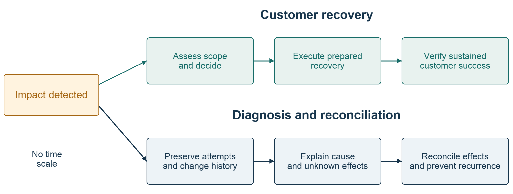

Figure 37. Overview retained from the earlier report. The detailed playbook below distinguishes impact detection, customer recovery, business reconciliation, and causal explanation.

### What adds difficulty in an active active incident

| Source of difficulty | Example | Control that makes the incident explainable |
| --- | --- | --- |
| One operation has multiple attempts | A commits; the response is lost; the client retries in B | Stable operation key, distinct attempt IDs, and a durable recorded outcome |
| The path changes during the event | DNS answers change while old connections still reach A | Actual serving Region, connection age, routing state, and change timestamps |
| Different paths observe different health | A canary succeeds while one customer's network cannot connect | Cohort-specific outcomes and independent observer locations |
| Regions execute different software | Only the new release in A mishandles a field written by B | Artifact, schema, message, and configuration versions on relevant evidence |
| Work outlives the HTTP request | A delayed consumer or old worker acts after evacuation | Message identity, causation, ownership epoch, and accepted or rejected effect |
| Recovery changes the system being investigated | Restarted processes lose local state and caches warm up | Capture bounded evidence early, record every intervention, and retain regional evidence |
| Shared dependencies obscure the scope | Both Regions depend on the same unavailable provider | Dependency inventory and the actual destination of each affected call |

These are mechanisms to test, not a claim that active-active always takes longer to diagnose. Standby still has routing transitions, shared dependencies, uncertain commits, and worker takeover. Active-active may provide useful concurrent comparison evidence when the Regions have comparable workloads and instrumentation.

The CTO's question should therefore become: **Can a responder reconstruct a representative failed operation, identify the affected boundary, and distinguish proven facts from unknowns within an agreed investigation target?** A count of dashboards or an architecture label cannot answer that question.

### Define separate incident outcomes

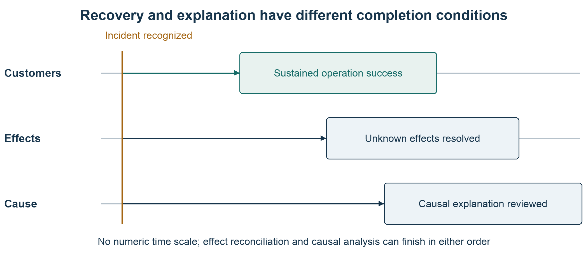

RCA diagram 1. Illustrative ordering of incident milestones, with no measured durations. Reconciliation may finish before or after causal analysis; the lanes are not a fixed dependency chain.

| Outcome | Proposed start and finish | Why it must remain separate |
| --- | --- | --- |
| Detection | First defined customer impact to its recognition | A fast routing mechanism cannot recover traffic that no one or no monitor recognizes as impaired |
| Decision | Recognized impact to the recorded action decision | Unclear authority or destination readiness can dominate the recovery path |
| Sustained customer recovery | First impact to the agreed successful operation and latency condition holding for a defined verification interval | A control action, green process, or temporary success spike is insufficient |
| Business reconciliation | Identification of unresolved effects to resolution or explicit business disposition | Service can accept new work while older outcomes remain pending |
| Causal reconstruction | Incident recognition to an evidence-supported explanation of a representative operation and affected boundary | Provides a practical measure of investigation usability |
| Full causal analysis | Incident recognition to a reviewed explanation of trigger, contributing conditions, propagation, and protection gaps | Often requires deeper service or provider investigation after customers recover |

Use explicit milestone timestamps and definitions, not one ambiguous MTTR number. Some intervals overlap. Set the verification interval, acceptable pending work, degraded functions, and investigation target before the exercise rather than choosing a favorable definition afterward.

When the first impact time is uncertain, retain the last known successful observation and the first known failure as an interval. Report that uncertainty rather than assigning an exact outage duration unsupported by the evidence.

### Organize recovery and investigation as parallel work

The incident commander maintains one impact statement, action log, and decision authority. Recovery responders restore the smallest safe customer capability. Investigators retain evidence, test hypotheses, and establish scope. Workflow owners reconcile unknown effects. These roles may be held by fewer people in a small team, but their responsibilities should remain explicit.

| Workstream | First useful action | Completion evidence |
| --- | --- | --- |
| Customer recovery | Identify working alternatives and execute the approved mitigation | Cohort-aware customer operations meet the recovery definition |
| Correctness and reconciliation | Enumerate accepted commands and unresolved external effects | No unprotected duplicate effect; pending states are resolved or explicitly owned |
| Diagnosis | Preserve the first failures, configurations, routing decisions, and representative attempts | A causal timeline with supporting records and clearly bounded unknowns |
| Coordination | Record decisions, owners, changes, and communication | Responders agree on the current operating state and the next decision |

Use an investigation playbook to discover the failing boundary and a recovery runbook to execute a known mitigation. AWS recommends maintained playbooks with escalation paths and companion runbooks; validate them with an engineer who did not write them. [\[S71\]](https://docs.aws.amazon.com/wellarchitected/latest/framework/ops_ready_to_support_use_playbooks.html)

A recovery that needs an invasive experiment should use the least disruptive evidence-gathering step that can distinguish the hypotheses. Do not prolong customer impact solely to retain an unmodified failing process when equivalent evidence can be captured safely.

### Build an evidence architecture that survives the incident

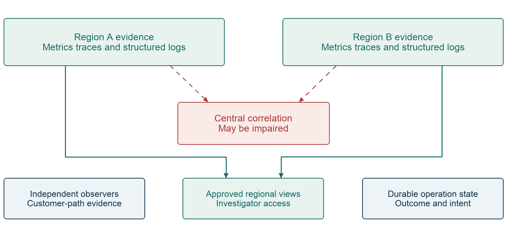

RCA diagram 2. Proposed evidence architecture. Central search is convenient, while local collection, approved regional access, and durable business records support investigation when a collector or Region is impaired.

| Evidence source | What it can establish | Limitation to preserve in the analysis |
| --- | --- | --- |
| Customer outcome counters and safe synthetic journeys | Which eligible operations or cohorts failed, and whether recovery held | A global aggregate can hide a smaller cohort; probes may miss short events |
| Application traces and structured attempt logs | The path, duration, release, dependency error, and retry history of recorded attempts | Missing instrumentation, dropped exports, or sampling can leave gaps |
| Durable operation and workflow records | The recorded business transition, deduplication outcome, pending intent, and reconciliation state | Only transitions explicitly modeled and persisted are recoverable from these records |
| Routing and configuration history | Which policy or control state changed and who initiated it | Intended state does not prove every client used the new path |
| DSQL Database Insights and DASH | Sampled active-session load, normalized SQL fingerprints, and wait-event distributions | It is sampled performance evidence, not a complete per-operation outcome ledger. [\[S69\]](https://docs.aws.amazon.com/aurora-dsql/latest/userguide/dsql-db-insights.html) |
| CloudTrail for DSQL | Management operations and configured connection-attempt data events | DSQL connection data events require configuration; they are not logged by default. They do not supply the business transaction outcome. [\[S68\]](https://docs.aws.amazon.com/aurora-dsql/latest/userguide/logging-using-cloudtrail.html) |
| AWS Health and provider evidence | Service event context and confirmed provider-side facts | A coincident public event or absence of one does not prove the cause of this application's failure |

AWS recommends distributed tracing across the request path, including attention to latency rather than errors alone. [\[S14\]](https://docs.aws.amazon.com/wellarchitected/latest/framework/ops_observability_dist_trace.html) For the proposed design, preserve a compact operation outcome record independently of whether its detailed trace is retained.

OpenTelemetry distinguishes head sampling from tail sampling. Tail sampling can select observed error or slow traces, but it requires a stateful collection path and cannot recover evidence already dropped earlier. Monitor collection and sampling health; an unrecorded trace must remain unknown rather than being counted as success. [\[S67\]](https://opentelemetry.io/docs/concepts/sampling/)

Keep the evidence proportional: structured identifiers, state transitions, durations, and sanitized error classes are often more useful than unrestricted payload logging. Use approved regional storage, access control, and retention for evidence. Do not put credentials, raw authentication tokens, or unnecessary personal content into logs.

### Establish a correlation contract before incidents

OpenTelemetry context propagation connects spans across services using trace context and can correlate logs with trace and span IDs. [\[S66\]](https://opentelemetry.io/docs/concepts/context-propagation/) A business operation can nevertheless span several traces, retries, or delayed messages. Give it a stable application identity as well.

| Field or relationship | Proposed meaning | Investigation question it answers |
| --- | --- | --- |
| Business operation ID | One caller intent across retries and Regions; scoped to caller and request content | Are these records attempts of the same requested action? |
| Attempt ID and parent attempt | A distinct execution or retry, with its initiating attempt where known | Which attempt failed, committed, or returned the response? |
| Trace and span IDs | Instrumented execution path and timing context | Where did the recorded attempt spend time? |
| Causation and event IDs | Relationship from command to message, consumer, callback, or derived update | Which earlier transition caused this later work? |
| Actual application Region and instance | Where the attempt executed | Did the caller reach the intended recovery destination? |
| Selected dependency and DSQL endpoint | Actual destination, not merely the configured preference | Was a hidden cross-Region path still in use? |
| Release and configuration revision | Artifact digest and effective settings for the attempt | Did regional or time-based behavior change with a deployment? |
| Entity version and ownership epoch | Version used for business preconditions and worker ownership | Was an old decision or stale executor accepted? |
| Transaction stage and error classification | Connect, authenticate, acquire pool, execute, commit, or return response | Is the failure before execution, during a conflict, or an uncertain commit? |
| Provider key and reference | Stable identity of an external action and its confirmed result | Was the effect accepted elsewhere despite a lost response? |
| Outcome state and confidence | Confirmed accepted, rejected, pending, or needs reconciliation | What is proven, and what remains unknown? |
| Event time, observed time, and coverage | When the emitter says it happened, when collected, and whether records are missing | Could clock differences or delayed export explain the apparent order? |

Use these high-cardinality IDs in logs, traces, and indexed records where appropriate. Keep metric dimensions bounded, such as Region, operation class, dependency, release cohort, and outcome. Logging a new routing generation can establish which configuration was observed; it does not itself fence a stale worker or enforce write ownership.

Prefer explicit causation and entity versions over sorting solely by wall-clock timestamps. A message accepted after another event is useful ordering evidence even when host clocks differ. Preserve uncertainty where the ordering cannot be established.

### Worked example of a lost response across Regions

**Illustrative scenario, not an observed AWS incident.** The order API's success contract is acceptance of an order; payment confirmation is a separate completion state. This distinction prevents an accepted order from being incorrectly described as a completed payment.

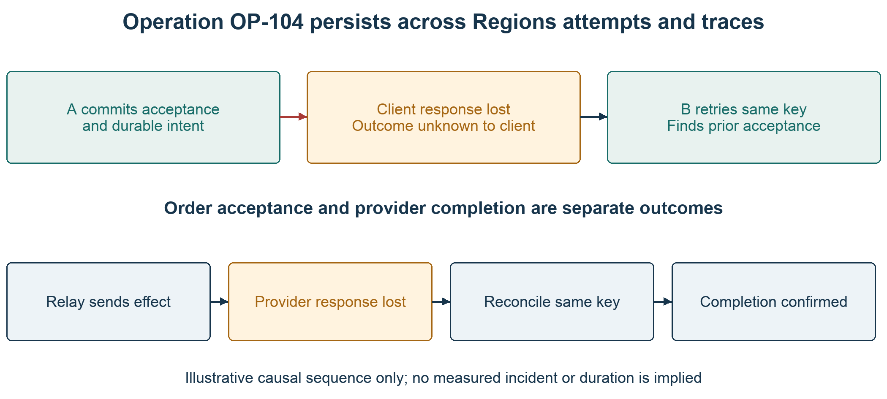

RCA diagram 3. One stable operation identity joins several attempts and traces. DSQL and provider outcomes are separate evidence boundaries.

| Sequence | Observed event | Safe interpretation | Evidence required |
| --- | --- | --- | --- |
| A | Client starts operation OP-104 in Region A | One caller intent begins | Caller-scoped operation key and payload fingerprint |
| B | A commits an accepted order and durable payment intent in one DSQL transaction | The order transition and intent are durable within that transaction boundary | Recorded operation outcome, order version, and intent ID |
| C | The response to the client is lost | The client does not know whether acceptance succeeded | Original attempt and response-path error; no assumption of rollback |
| D | The client retries OP-104 through Region B | This is another attempt of the same intent | Same operation key, new attempt ID, and actual Region B |
| E | B finds the prior acceptance outcome and returns it | The API can recover without creating a second order | Deduplication decision protected against concurrent attempts |
| F | A relay calls the provider with a stable effect key; its response is lost | The external effect is unresolved, even if the provider may have accepted it | Intent state, effect key, and exact attempt record |
| G | A valid replacement worker queries or safely retries using the provider's contract | Takeover does not justify an unprotected duplicate call | Ownership validation plus provider idempotency or reconciliation evidence |
| H | Provider acceptance is confirmed and the workflow records completion | The business completion state is now known | Provider reference and final workflow transition |

The outcome record makes E possible even if the original trace was not retained. The provider reference makes H explainable even though the database alone cannot establish F's external outcome. An investigator should be able to join A through H without matching records by approximate timestamps or customer names.

AWS explicitly documents uncertain DSQL commit outcomes. A commit-time error may follow a successful commit; check the outcome or use a transaction design that is safe to repeat. [\[S05\]](https://docs.aws.amazon.com/aurora-dsql/latest/userguide/troubleshooting.html) The outbox and effect-key design above is a proposed application implementation of the earlier R4 and R5 controls. [\[S16\]](https://docs.aws.amazon.com/prescriptive-guidance/latest/cloud-design-patterns/transactional-outbox.html)

### Diagnose from customer impact toward the failing boundary

Use the smallest representative operation with known context, then compare affected and unaffected cohorts with equivalent operation type, version, and contention. Regional totals alone can differ because their traffic mixes differ.

| Symptom | Positive evidence to seek | Alternative that must remain open |
| --- | --- | --- |
| Clients fail while health checks pass | Actual client Region, resolver answer, connection age, and regional journey result | Partial network failure or a shallow health check |
| Pool acquisition is slow | In-use connections, pending acquisition, transaction duration, and connection creation rate | Application pool saturation without a database outage |
| New DSQL connections fail | DNS, TCP/TLS/SNI stage, principal validity, endpoint identity, and authorization error | Credential or trust failure rather than regional reachability |
| Token generation succeeds but connection fails | Validity of the underlying IAM credentials and the connection result | Token generation signs locally and does not validate credentials with AWS. [\[S32\]](https://docs.aws.amazon.com/aurora-dsql/latest/userguide/SECTION_authentication-token.html) |
| DSQL commit-related waits rise | DASH wait profile, query fingerprint, transaction errors, and equivalent baseline | A Commit wait precedes both success and abort; it does not establish a successful commit. [\[S69\]](https://docs.aws.amazon.com/aurora-dsql/latest/userguide/dsql-db-insights.html) |
| Database Insights shows no representative query | Application attempt and outcome record, workload duration, sampling coverage, and selected Region | A fast transaction may fall between samples; absence is not proof of no execution. [\[S05\]](https://docs.aws.amazon.com/aurora-dsql/latest/userguide/troubleshooting.html) |
| API requests recover but completion work stalls | Pending intent age, relay progress, consumer takeover, and provider result | Partial business recovery with an unresolved processing path |
| Both Regions fail after a deployment | Effective artifact/configuration revisions and first affected operations | A shared application change rather than two independent regional outages |
| Trace path is incomplete | Propagated context, sampling decision, export backlog, and collector health | An observation gap rather than a missing business event |

A retry succeeding narrows the symptom but does not prove the original cause. Likewise, a successful regional evacuation shows a working mitigation under those conditions; it does not establish whether the original trigger was the network, application configuration, a provider, or an internal AWS service event.

### Explain the trigger and the failure that sustained it

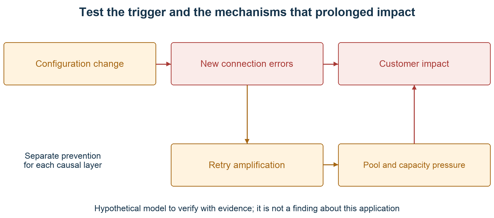

RCA diagram 4. A proposed causal model to test, not a finding about this workload. The remedy for the trigger can differ from the remedy for the feedback loop that prolonged impact.

For each material hypothesis, record the observation supporting it, a competing explanation, a discriminating observation or safe experiment, and a confidence level. A useful causal report separates:

| Layer | Example in a hypothetical incident | Corrective action to evaluate |
| --- | --- | --- |
| Trigger | A configuration change breaks new connections in A | Staged configuration rollout and compatibility validation |
| Propagation | Unbounded retries consume the remaining worker and pool capacity | One coordinated retry budget, backpressure, and admission control |
| Recovery limitation | B receives customer traffic and background catch-up simultaneously | Tested destination capacity and prioritized catch-up |
| Detection gap | Checks cover process liveness but not customer writes | Representative regional and customer-path observations |
| Evidence gap | Logs omit endpoint choice or operation identity | Correlation contract and durable transition evidence |
| Prevention gap | Exercises never combine a partial failure with collector loss | A regression exercise that tests the combined scenario |

Do not label a nearby deployment or AWS Health event as the cause without connecting it to the affected path. Keep multiple contributing factors where the evidence supports them. AWS post-incident guidance calls for evidence-supported contributing factors, clear owners, corrective actions, and examination of why existing tests missed the issue. [\[S72\]](https://docs.aws.amazon.com/wellarchitected/latest/framework/rel_testing_resiliency_rca_resiliency.html)

The public Maelstrom paper is a useful operational companion: it describes dependency- and capacity-aware datacenter traffic draining, with health feedback and production recovery exercises. Its principles inform this design; its deployment results are not an Aurora DSQL recovery-time promise. [\[S73\]](https://www.usenix.org/conference/osdi18/presentation/veeraraghavan)

### Decide what the team can establish and what requires service evidence

| Owner | Question to answer | Evidence to provide or retain |
| --- | --- | --- |
| Incident commander | What customer impact continues, and which action has authority? | Impact statement, action decision, destination-readiness result, and timeline |
| Application and workflow owners | Which attempts and effects occurred, and is business state correct? | Operation history, transaction stages, entity versions, provider keys, and unresolved states |
| Platform and observability owners | Which routes and dependencies were used, and is telemetry trustworthy? | Routing state, client-path observations, collection health, and configuration changes |
| AWS Support where needed | Was a service-internal condition responsible for the observed boundary failure? | Sanitized times, account and Region, cluster and endpoint identifiers, driver version, error codes, available request identifiers, and representative attempt records |
| External provider where needed | Was the requested external effect accepted or completed? | Provider operation key, reference, attempt times, and its confirmed outcome |

The customer team can often establish impact and the failing boundary before AWS or a provider completes an internal investigation. A complete account of service internals may require evidence the application cannot directly access. Record that limitation explicitly rather than inventing a deeper cause.

### Compare active active and standby with the same exercises

| Exercise | Customer-recovery evidence | Diagnostic and correctness evidence |
| --- | --- | --- |
| A regional path is impaired | Affected cohorts recover within the agreed objective | The failed path and actual destination are reconstructed |
| Old DNS and persistent connections remain | Long-lived as well as new clients regain service | Routing intention is distinguished from actual connection placement |
| A commits and loses the response | The retry returns the correct prior outcome | Both attempts join to one accepted transition |
| A worker resumes after takeover | Processing continues within the completion objective | The stale executor cannot create an unprotected duplicate effect |
| A shared provider degrades | Approved degraded behavior contains impact | Pending effects and provider uncertainty remain visible |
| The central collector fails | Regional decision evidence remains available | Missing telemetry is quantified and one operation is reconstructed from retained records |
| Both Regions receive a bad release | Containment or rollback restores useful operations | Release history distinguishes a common cause from regional infrastructure failure |
| Failback coincides with queued work | Return remains stable without a new surge | Versions, ownership, attempts, and backlog progress remain explainable |

Use the same DSQL topology, workload mix, customer SLO, observation coverage, fault conditions, and responder experience for the comparison. Have an engineer unfamiliar with the exercise use the playbook. Record time spent obtaining access, locating evidence, joining attempts, reconciling effects, and establishing the failing boundary. Repeat where a learning effect would otherwise favor the second design tested.

**Proposed CTO acceptance.** Approve an operating model when it meets the agreed customer recovery and correctness objectives, provides a working evidence path during its intended failure scenarios, and permits representative incident reconstruction within the agreed target. Each unresolved external effect has an owner and resolution path; every corrective action has a responsible owner and a verification exercise. Choose between active-active and standby from these results rather than assuming a universal complexity ranking.

### Additional investigation sources

- [\[S66\]](https://opentelemetry.io/docs/concepts/context-propagation/) OpenTelemetry context propagation.
- [\[S67\]](https://opentelemetry.io/docs/concepts/sampling/) OpenTelemetry sampling and collection trade-offs.
- [\[S68\]](https://docs.aws.amazon.com/aurora-dsql/latest/userguide/logging-using-cloudtrail.html) Aurora DSQL logging with CloudTrail.
- [\[S69\]](https://docs.aws.amazon.com/aurora-dsql/latest/userguide/dsql-db-insights.html) Aurora DSQL Database Insights and DSQL Active Session History.
- [\[S70\]](https://docs.aws.amazon.com/wellarchitected/latest/operational-excellence-pillar/responding-to-events.html) AWS Operational Excellence responding to events.
- [\[S71\]](https://docs.aws.amazon.com/wellarchitected/latest/framework/ops_ready_to_support_use_playbooks.html) AWS OPS07 BP04 investigation playbooks.
- [\[S72\]](https://docs.aws.amazon.com/wellarchitected/latest/framework/rel_testing_resiliency_rca_resiliency.html) AWS REL12 BP02 post-incident analysis.
- [\[S73\]](https://www.usenix.org/conference/osdi18/presentation/veeraraghavan) Maelstrom, OSDI 2018, for production traffic-draining and recovery principles.

## AWS guidance and Aurora DSQL qualifications

**Reading context.** The requested architecture article is dated 23 June 2021. The fundamentals PDF is a living guide reviewed on 14 November 2026; its printed page numbers below exclude the cover and front matter. These sources explain strategy and operating practice, while current service guides establish DSQL and routing behavior.

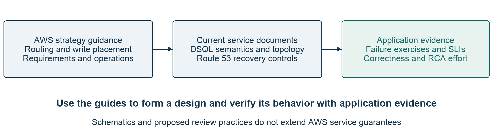

Figure 38. How to apply the two guides to this report. Application evidence is required before accepting the proposed operating model.

| **Guidance or wording** | **Qualification for this report** |
| --- | --- |
| Local, global, and partitioned writes | Application placement options; both DSQL serving endpoints can accept reads and writes. [\[S57\]](https://aws.amazon.com/blogs/architecture/disaster-recovery-dr-architecture-on-aws-part-iv-multi-site-active-active/) [\[S02\]](https://docs.aws.amazon.com/aurora-dsql/latest/userguide/disaster-recovery-resiliency.html) |
| Near-zero recovery potential | A strategy goal, not a measured customer RTO or an application availability guarantee. [\[S57\]](https://aws.amazon.com/blogs/architecture/disaster-recovery-dr-architecture-on-aws-part-iv-multi-site-active-active/) |
| Synchronous replication and write latency | Measure the actual DSQL topology and workload; generic latency multipliers are not service benchmarks. [\[S59\]](https://docs.aws.amazon.com/prescriptive-guidance/latest/aws-multi-region-fundamentals/fundamental-2.html) [\[S38\]](https://arxiv.org/abs/2607.13276) |
| Independent Regions | Localize application dependencies while recognizing DSQL managed coordination and shared third parties. [\[S12\]](https://docs.aws.amazon.com/prescriptive-guidance/latest/aws-multi-region-fundamentals/fundamental-3.html) |
| Additional multi-Region cost | Use an equal-objective cost model; general doubling examples do not rank active-active against hot standby. [\[S58\]](https://docs.aws.amazon.com/prescriptive-guidance/latest/aws-multi-region-fundamentals/fundamental-1.html) [\[S23\]](https://docs.aws.amazon.com/wellarchitected/latest/cost-optimization-pillar/welcome.html) |

### Requested sources and applied reading path

[\[S57\]](https://aws.amazon.com/blogs/architecture/disaster-recovery-dr-architecture-on-aws-part-iv-multi-site-active-active/) **AWS DR Architecture Part IV Multi site Active Active.** Read Traffic routing, Read/write patterns, and Failover. Applied on pages 40 and 41.

[\[S36\]](https://docs.aws.amazon.com/pdfs/prescriptive-guidance/latest/aws-multi-region-fundamentals/aws-multi-region-fundamentals.pdf) **AWS multi Region fundamentals full PDF.** Read requirements on pages 4 to 6, data on 7 to 10, dependencies on 11 to 13, and operational readiness on 14 to 18. Applied on report pages 40 to 43.

Direct chapter links: requirements [\[S58\]](https://docs.aws.amazon.com/prescriptive-guidance/latest/aws-multi-region-fundamentals/fundamental-1.html); data [\[S59\]](https://docs.aws.amazon.com/prescriptive-guidance/latest/aws-multi-region-fundamentals/fundamental-2.html); dependencies [\[S12\]](https://docs.aws.amazon.com/prescriptive-guidance/latest/aws-multi-region-fundamentals/fundamental-3.html); operational readiness [\[S13\]](https://docs.aws.amazon.com/prescriptive-guidance/latest/aws-multi-region-fundamentals/fundamental-4.html). Existing service behavior and availability references remain on report pages 29, 30, and 39.

**Decision.** Select active-active when its tested recovery or geographic benefit justifies the application ownership and operating work. Select standby when its tested recovery meets the same business need with less operating effort. Neither the database SLA nor the strategy label decides this choice.
